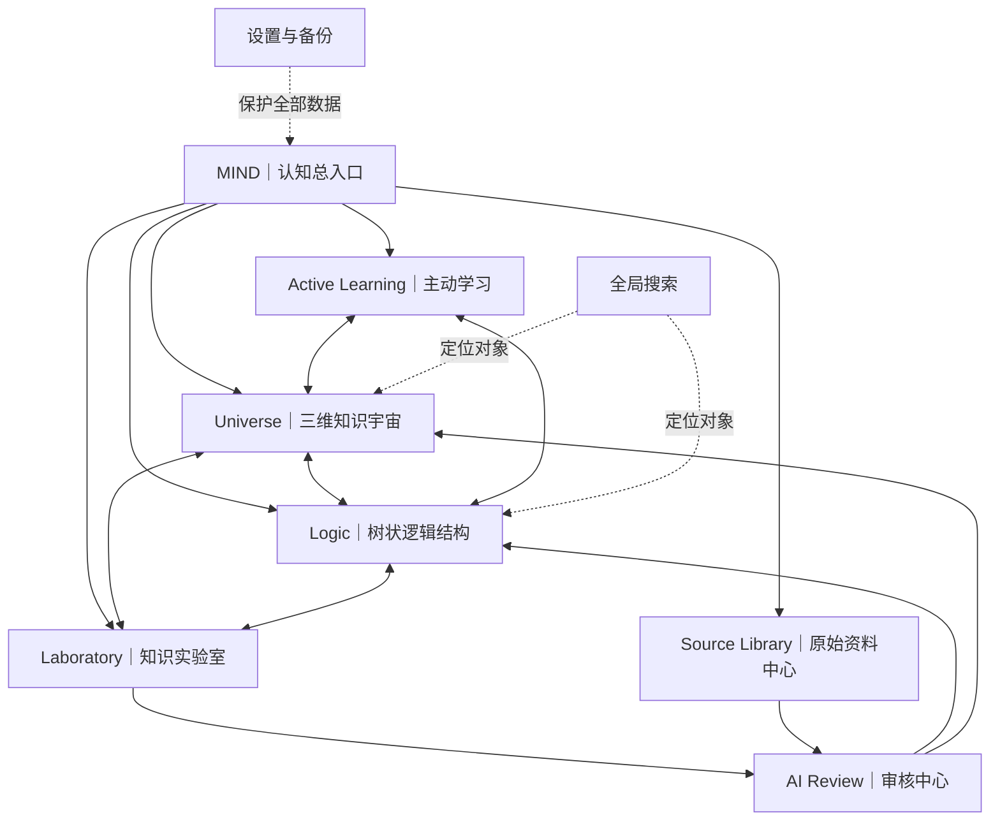
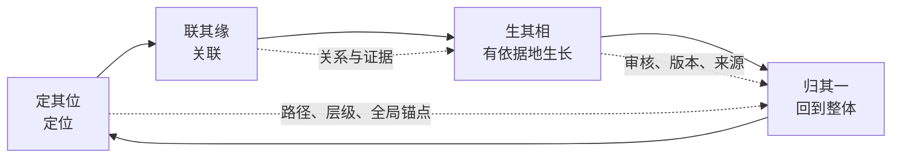
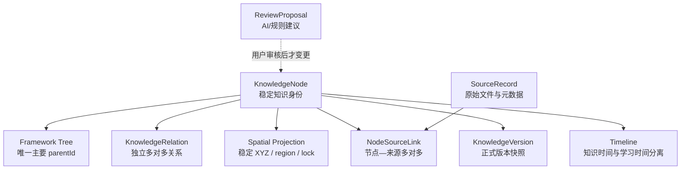
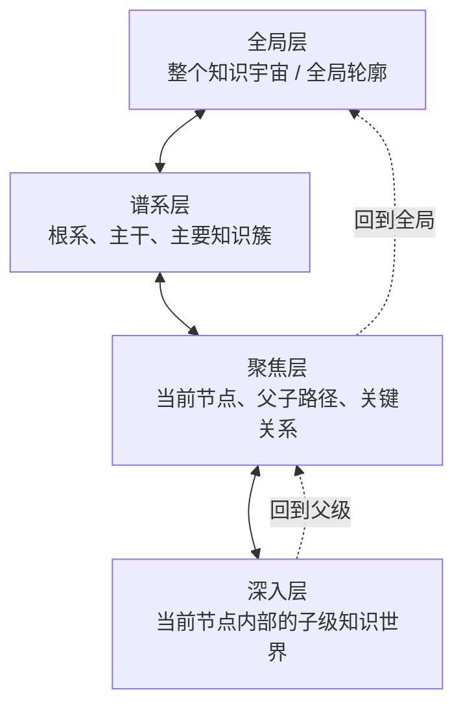

# MIND V2.0｜整体架构与核心交互设计交付

**版本：V2.0｜日期：2026-11-07｜阶段：第一阶段——架构先行**

> **聚焦一点，仍知全局；生发万象，终归其一。**
>
> 本文将 MIND V2.0 总任务书转化为可实施的产品架构、知识对象边界、空间投影规则和核心交互验收。它不代表所有页面或功能已经实现。

## 0. 本阶段的设计决策

MIND 是个人认知操作系统，不是普通思维导图、AI 聊天工具或 3D 展示页。

整个系统必须同时保留三个彼此独立、通过稳定 ID 联动的表达层：

1. **树（Framework / Tree）是骨架**：表达知识的唯一主要谱系归属、上下级、同级与递归层级。
2. **网（Relations / Network）是关系**：表达跨层、跨分支、跨时间、跨领域、因果、证据、冲突、互补等多对多联系。
3. **图（Universe Map / Spatial Map）是全局**：表达知识对象在整个认知宇宙中的空间位置、区域、层级、焦点、路径和返回全局的锚点。

三者不是同一种图的三种皮肤，不共享一套混合边集合。它们共享知识对象身份，但各自拥有清晰的数据语义、布局算法和交互职责。

**禁止事项：** 不得将所有 parent-child 与 cross-link 混合成一个无类型的节点连线图；不得让 3D 坐标反过来决定知识层级；不得把视觉邻近误判为知识关系。

## 1. 产品信息架构

### 一级导航

| 一级入口 | 核心任务 | 主要对象 |
|---|---|---|
| Mind | 看见当前认知状态、待处理问题与下一步 | 认知上下文、缺口、待审核、待复习 |
| Universe | 在真实 XYZ 空间中定位、聚焦、递归进入 | 知识节点、空间投影、焦点上下文 |
| Logic | 整理、确认和理解知识谱系 | Framework、树节点、逻辑路径 |
| Laboratory | 研究、比较、质疑、验证 | 研究会话、证据、假设、反例 |
| Learning | 复述、回忆、应用、迁移 | 学习活动、掌握证据、复习计划 |
| Sources | 保全并阅读原始资料 | 原始文件、提取片段、来源定位 |

AI Review、Search、Settings 作为全局辅助入口，不挤占一级导航。低频入口默认收敛；侧边栏默认收起，空间主场景优先。

## 2. 四阶段认知流程

四阶段是跨模块的统一交互协议，不是四个孤立功能页面。任何节点详情、研究、学习或 AI 反馈，都应能回答当前焦点、谱系路径、关系上下文、证据来源和返回整体的方式。

## 3. 三层数据语义与关系边界

### 3.1 共享的知识身份层

每个正式知识对象使用稳定且不可因改名、移动或重排而变化的 `nodeId`。推荐核心字段：

| 字段 | 含义 | 约束 |
|---|---|---|
| id | 稳定身份 | 永不由坐标或标题生成 |
| title / coreWord | 名称与核心词 | 可版本化修改 |
| description | 当前认可解释 | 与原文、AI 草稿分开 |
| parentId | 唯一主要谱系父级 | 树结构；根节点为空 |
| frameworkId | 所属框架/知识宇宙 | 允许未来跨框架引用 |
| status | draft / active / needs_review / archived | 正式与待审分离 |
| evidenceState | direct / corroborated / inference / opinion / unverified / disputed | 证据等级，不等同用户掌握度 |
| knowledgeTime | 知识自身时间 | 可为未知或区间 |
| createdAt / updatedAt | 系统记录时间 | 不替代知识时间 |
| currentVersionId | 当前正式版本 | 版本可追溯 |

### 3.2 树：Framework Tree

- 每个节点在同一框架内只有一个主要 `parentId`，由此形成清晰的根系、主干、分支和叶片。
- 同级节点应具有同等级的结构意义；进入某节点后，下一层展示其内部世界的同级子结构，不重复渲染父层平行节点。
- 树的边只表达主要归属与层级，不承载因果、时间、相似、证据等其他语义。
- 允许用户调整结构，但必须形成版本记录、变更理由和可撤销操作。

### 3.3 网：Knowledge Relations

关系单独存储，最少包括：

- `id`、`sourceNodeId`、`targetNodeId`
- `type`：causal / contrast / prerequisite / analogy / application / related / evidence_for / challenges / temporal_before / temporal_after / domain_context
- `label`、`rationale`、`evidenceState`
- `sourceIds` / relation evidence、创建者、时间、审核状态

关系必须有语义、理由与依据；关系允许多对多、跨层和跨分支。无证据时显示“待探索/待验证”，不自动补造关系。树的 parentId 与关系边永不混用。

### 3.4 地图：Universe Spatial Projection

地图是知识身份与空间位置的投影，不是知识真相的来源。

每个节点的空间投影至少包括：

- `nodeId`、`frameworkId`、`x/y/z`
- `layoutVersion`、`regionId`、`depthBand`
- `positionSource`：algorithm / user_locked / imported
- `locked`、`updatedAt`

规则：
- XYZ 由谱系、已确认关系、领域区域和时间属性共同影响，但坐标不得创建或删除知识关系。
- 使用稳定、可重复计算的布局种子与布局版本；相同输入不能每次随机漂移。
- 用户锁定的重要节点位置优先于自动布局；重排前提供预览与撤销。
- 全局、谱系、聚焦、深入四种尺度是同一地图的不同视距/过滤层，不是四套互不相关的场景。
- 地图显示的邻近只说明空间位置，不自动说明语义关联。

## 4. 三位一体数据关系图

## 5. 三维空间层级与导航

- 全局层：识别宇宙轮廓、主要领域与当前焦点位置。
- 谱系层：看见同级主干、分支与明确的父子结构。
- 聚焦层：当前节点柔和突出，周围节点按关系类型按需显示。
- 深入层：递归进入节点内部世界，镜头连续过渡并保留父级锚点。
- 任何层级都必须有轻量路径导航和可唤起的小地图；小地图低对比度、低占用，聚焦时仍显示全局参照。

## 6. 核心交互原型（文字验收流程）

### A. 全局 → 节点 → 小地图 → 回归整体
1. 打开 Universe，默认呈现真实知识数据；若为空则明确标注空状态，不以演示数据冒充正式知识。
2. 选择节点，镜头平滑聚焦；节点详情显示名称、层级、所属框架、父级路径、子级入口和证据状态。
3. 小地图同步显示全局轮廓、当前焦点和父级路径；点击小地图可定位，不改变知识数据。
4. 用户可返回父级、当前框架或全局，返回后保留原有空间锚点。

### B. 焦点 → 四维关系 → 证据
1. 聚焦节点后打开四维关系视图：谱系纵向、知识时间、领域/世界、横向关联。
2. 每条关系显示类型、方向、理由、证据状态；未确认内容明确标记待验证。
3. 点击关系可定位另一节点；关系浏览不改变树的 parentId。
4. 点击证据打开 Evidence Panel，保留文件类型、文件名、页码/段落/导图路径及原始内容与 AI 整理内容的区别。

### C. 递归进入 → Logic → 回到整体
1. 从第一层节点进入其内部第二层同级结构。
2. 再进入第二层节点，展示第三层；面包屑持续显示路径。
3. Logic 视图只突出当前树枝及其祖先路径；横向关系单独叠加或在关系模式查看。
4. 返回时回到先前焦点、缩放和视角，不重置整个宇宙。

### D. AI 提议 → 审核 → 版本
1. AI 读取当前焦点、用户选择的上下文和必要来源，不默认上传整库。
2. 输出提议、理由、证据定位、不确定性和反例。
3. 用户可接受、编辑后接受或拒绝。
4. 只有接受后才写入正式知识；写入前后均保留版本、来源和撤销路径。

### E. 主动学习 → 认知闭环
1. 从当前节点生成复述、回忆、比较、应用或迁移任务。
2. 反馈不只给对错，还要标注遗漏、证据依据、关联断层和回到整体的路径。
3. 学习时间与知识本身的历史时间分开记录。
4. 学习表现只作为掌握证据，不等同知识真伪或 AI 置信度。

## 7. 视觉系统增量约束

- 保留已确认的深黑宇宙、冷蓝微光、工程化精密感与克制留白；九张主参考仍是 UI 主依据，新六图只作尺度、纵深与叙事氛围辅助。
- 不使用用户参考图片作为页面背景，不重绘、裁切、调色或替换原图；仅提炼其概念原则。
- 节点像安静星点：普通节点小而清晰；焦点柔和亮起；后方核心点略缩小；发光不覆盖文字。
- 关系线按需出现，按关系类型和证据状态区分；默认不制造蜘蛛网。
- 幽灵式隔离层只提供轻微边界与低强度磨砂，不做厚重毛玻璃。
- 荧光绿只用于极小定位/状态提示；不得大面积铺色。
- 侧栏默认收起；小地图常驻但低对比；单一主焦点优先。
- 动效服务于定位与理解：缓慢、连续、可减少动态效果；避免爆闪、粒子爆炸和大幅旋转。

## 8. 认知质量与证据状态

知识缺口不以节点数量衡量，至少区分：
- 定义不清
- 起源/前置条件缺失
- 机制或因果链断裂
- 缺少案例或应用
- 缺少反例与适用边界
- 来源或证据不足
- 与其他知识存在未解释矛盾
- 用户尚不能独立复述或迁移

证据等级与学习掌握度必须分开。AI 推断、用户观点、待验证内容不能呈现为已被原始资料直接证明的事实。

## 9. 交付顺序与阶段门

本任务书要求先交付架构与交互，再推进完整 UI。执行顺序：

| 阶段 | 交付 | 通过条件 |
|---|---|---|
| 1. 整体架构 | 本文：信息架构、三位一体模型、四阶段流程、空间层级 | 用户确认树/网/地图边界清楚 |
| 2. 空间结构 | 全局/谱系/聚焦/深入布局规则、稳定坐标、定位与回归 | 坐标不决定知识语义；重开不漂移 |
| 3. 核心原型 | 进入、聚焦、小地图、四象限、递归、证据、返回、审核流程 | 关键路径可实际操作，真实数据驱动 |
| 4. 视觉系统 | 在已认可风格上统一节点、关系线、面板、动效 | 不偏离九张主参考，不使用虚构替代图 |
| 5. 模块扩展 | Laboratory、Learning、Sources、Review 全流程 | 真实数据、来源、审核与撤销闭环 |
| 6. 正式迁移 | 预览验收后再评估正式入口迁移 | 备份、回滚、桌面/窄屏实测通过 |

## 10. 当前仓库基线与诚实状态

截至本次架构梳理，仓库已经具备较多后台基础：IndexedDB 本地优先存储、知识节点与关系、来源及节点来源链接、版本、审核提议、过滤工作台、四维关系建议、空间投影/节点位置、学习记录、研究会话、备份恢复和证据解析等 API/数据结构。

当前预览页已经包含 Three.js/WebGL 空间、节点聚焦、连续路径/面包屑、小地图、四向入口、来源详情和部分工作台交互。但**页面存在控件或后台 API，不等于完整业务闭环已验收**。尤其需要实测：
- 三个投影是否在 UI 中真正分开呈现，而非视觉混合；
- 第二层/第三层是否严格按当前父节点递归；
- 小地图是否支持可用的点击定位与全局回归；
- 四象限是否读取真实关系与证据，而不是演示映射；
- 树与网切换是否保留焦点和空间状态；
- Evidence Panel 是否能从节点准确跳回原始文件位置；
- AI Review 是否确实先提议、人工确认后才改变正式知识；
- 桌面、窄屏、触控和低性能设备的实际表现。

当前预览仍是独立预览入口，不能称为正式产品页面已经完成迁移。任何未通过真实数据和浏览器交互验收的能力均标注“设计中/待验证”，不得宣称已完成。

## 11. V2.0 第一轮验收清单

- [ ] 树只表达唯一主要谱系归属。
- [ ] 网只表达有类型、有理由的多对多关系。
- [ ] 地图只表达可复现的空间投影，不反向制造知识关系。
- [ ] 全局、谱系、聚焦、深入四种视距连续切换。
- [ ] 任意焦点始终可见全局位置、父级路径和返回入口。
- [ ] 四维关系分别表达谱系、知识时间、领域/世界、横向关联。
- [ ] 知识时间与学习时间分离。
- [ ] 原始资料、提取内容、AI 分析、用户确认知识分层保存。
- [ ] 每条 AI 修改建议可审阅、拒绝、编辑、接受、追溯和撤销。
- [ ] 空状态不以样例知识冒充用户正式知识。
- [ ] 所有参考图保持原样；概念提炼不得伪装成用户原图。
- [ ] 先通过架构与交互原型，再进入完整 UI 与正式入口迁移。

**最终验收原则：树清晰、网有据、地图可归；聚焦一点，仍知全局。**
