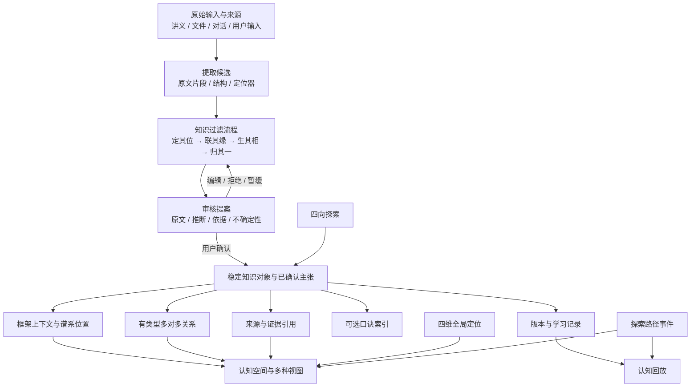
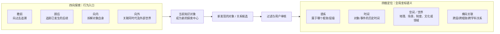
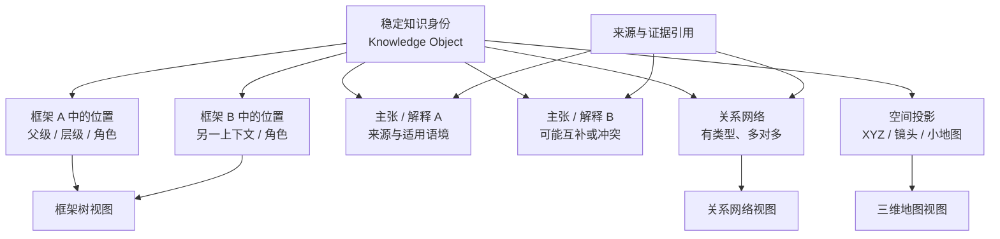
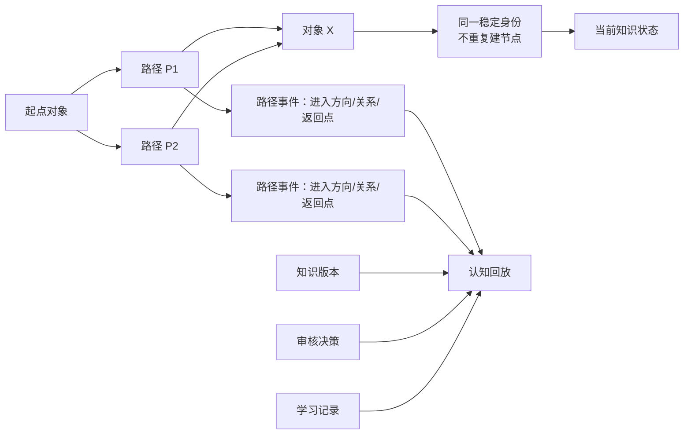
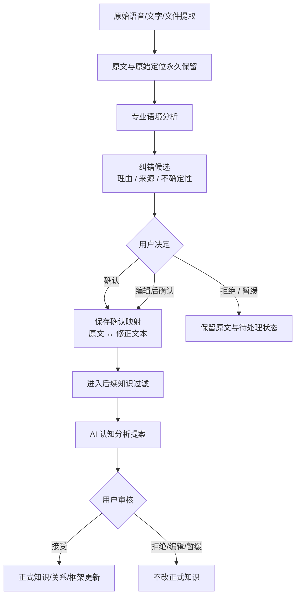

# MIND｜V3.2 架构一致性审查与统一修订

**日期：2026-11-08**  
**审查基线：main 分支 V3.1 决议、V3.1 设计任务书、最高设计总纲、实施蓝图、NEBULA Skill**  
**本轮性质：架构文档审查与规范校准；不改 UI、产品代码、数据库、正式数据或后台。**

> 本报告是 V3.1 架构统一阶段的审查补充，不推翻用户已审议的 13 项选择。任何概念补充都不等于数据库 schema 或工程实现授权。

> **状态说明（V3.3，2026-11-08）：** 本报告中的“四向探索 × 四维定位正交分层”图解与结论已被用户后续明确纠正，现只作为历史审查记录，不再是有效产品定义。请以 [V3.3 四向四维一体模型正式校正](MIND-V3.3-FOUR-DIRECTIONS-FOUR-DIMENSIONS-UNIFIED-MODEL.md) 及 [V3.3 实体关系与状态规格](MIND-V3.3-ENTITY-RELATIONSHIP-AND-STATE-SPEC.md) 为准。树/网/地图、稳定身份、路径与对象分离、审核、原文保全、视觉 old 等未冲突内容仍可参考。

## 1. 审查结论

V3.1 的核心方向成立：四向探索与四维定位分层；稳定知识身份与多种视图分离；树、网、地图不混用；路径记录抵达过程；AI 只提案、用户确认；原始资料保留；视觉与空间化表达维持 old。

但对照仓库历史规范，仍有 **4 项必须校准的规范冲突** 和 **5 项需要在进入数据规格前明确的概念边界**。

### 1.1 必须校准的规范冲突

| 编号 | 发现 | 风险 | 修订 |
|---|---|---|---|
| C1 | `docs/NEBULA-SKILL.md` 仍定义「前瞻/顾后/左顾/右盼」四面板，并把左顾/右盼写成横向/反向思考 | 与 V3.1 统一四向「瞻前/顾后/向内/向外」直接冲突 | Skill 更新为 V3.1 术语；旧四向只作为历史表达，不再作为产品模型 |
| C2 | Skill 把「顾后」扩展为 plausible futures（可能未来） | 将历史后续研究与未来预测混为一谈 | 顾后只研究已经发生、可考察的继承/演变/影响/结果；预测若未来另行定义，不属于当前四向 |
| C3 | Skill 把时间写成「3D 之上的第四维」 | 混淆三维空间投影与四维认知定位 | 时间是独立认知定位维度，不是把三维坐标强行改成 4D 物理空间 |
| C4 | 实施蓝图把 domain/context/world membership 作为空间世界表达，但历史实现记录已指出领域标签不等于空间关系 | 可能把同领域误画成空间邻居或知识关系 | 区分地理/场景/制度/文化世界/知识领域的语义类型；领域归属不能自动推导空间邻接或直接关系 |

### 1.2 需要在阶段 B 前明确的概念边界

1. **知识对象与主张/解释分离。** 稳定知识对象回答“我们在谈什么”；不同来源、时代、学派或用户语境中的解释/主张回答“有人如何理解或断言它”。同一对象可承载多条不同主张；冲突主张不得覆盖对象身份或被静默合并。
2. **框架归属必须带上下文。** 旧实现中的单一 `parentId` 只能表达一个主要父子位置，不能独自承担“同一对象进入多个框架”。概念上应把“框架中的位置/角色”与“知识对象身份”分开；具体实体和迁移留阶段 B 审查。
3. **关系、定位标签与空间邻近分离。** “属于某领域”“发生在某地”“与某对象存在因果/影响关系”“在画面上靠近”是四种不同事实。它们不能共用一个含糊的 relation 或坐标推断。
4. **路径与对象分离。** 路径是一次有上下文的访问过程；一个对象可在多条路径重复出现。路径事件不能复制知识对象，也不能自动改变框架位置或关系事实。
5. **回放不是单一学习时间线。** 知识版本变化、探索路径、审核决策、来源导入、学习表现属于不同事件类型；可以在回放中按时间聚合，但不能混成一个“知识正确性/掌握度”字段。

## 2. 统一架构总览

**图解：** 所有输入先成为来源和候选，不能直接跳进正式框架。过滤流程把原文、推断、关系建议和不确定性整理成审核提案。只有用户确认后，正式知识对象、框架位置和关系才发生变更。Mind 的三维空间是这些已确认知识与关系的呈现/导航层，不是知识身份的来源。四向负责“继续探索什么”，四维负责“对象在全局哪里”；路径与回放分别记录“怎么抵达”和“认知过程如何变化”。

## 3. 四向探索 × 四维定位：两个正交层次

**图解：**
- 四向是动作：沿时间向前后追问，向对象内部深入，向外部世界扩展。
- 四维是定位：记录对象属于什么谱系、处于什么历史时间、处于什么空间/世界语境、与哪些对象存在横向关系。
- 一个“向外”发现的人物，进入后仍可成为新的探索中心；他的四维定位需要重新确认。
- 四维不是四个必填字段，也不是四个固定象限按钮；未知、待确认、不适用均是合法状态。
- “同一时代”不等于“互相影响”；“同一领域”不等于“空间相邻”；“先发生”不等于“导致”。

## 4. 知识对象、框架树、关系网络与空间地图

**图解：**
- 稳定知识身份是“对象本身”，不是某棵树上的某个坐标。
- 同一对象可以出现在多个框架上下文中；每个上下文有自己的谱系位置和角色。
- 框架树只表达某个框架里的结构归属；关系网络表达多对多语义联系；三维地图表达空间投影和导航。
- 同一对象的不同主张/解释要保留来源、语境和版本。不能因为对象身份相同，就把不同观点合并成一个无差别摘要。
- XYZ 坐标只负责呈现，不决定身份、父子关系、因果关系或领域归属。

## 5. 多路径探索与认知回放

**图解：** 两条路径都能抵达对象 X，但 X 仍是同一个知识身份。路径 P1/P2 各自保留进入方向、上一步、关系上下文和返回点。回放可以按时间串起路径事件、知识版本、审核决策和学习记录，但必须保留事件类型。回放默认只读；恢复旧知识版本必须由用户明确执行。

## 6. 专业纠错与 AI 审核边界

**图解：** 纠错只是对识别文本提出候选，不得改写原件。用户确认的修正文本也必须能追溯回原始转写。之后 AI 才能基于修正文本提出知识分析；正式知识仍走独立审核。识别置信度、AI 推断和用户确认是不同状态，不能混成一个“正确率”。

## 7. 阶段 B 必须继续明确的实体边界（概念草案，非数据库批准）

| 概念 | 负责什么 | 不负责什么 |
|---|---|---|
| KnowledgeObject | 稳定身份、名称、对象类型 | 不承载所有语境下唯一解释 |
| Claim / Interpretation | 某来源/主体在某语境下的主张或解释 | 不替代对象身份 |
| FrameworkPlacement | 对象在某个框架中的位置、父级、角色和版本 | 不等同全局唯一 parentId |
| KnowledgeRelation | 对象之间有类型的多对多关系 | 不表达空间画面邻近 |
| WorldContext | 地理/场景/制度/文化/领域等语义上下文，需标明子类型 | 不自动生成直接关系 |
| ExplorationPath / PathEvent | 一次探索路径及每一步抵达/返回事件 | 不复制知识对象 |
| CorrectionProposal | 原始识别与候选修正的关联及用户决策 | 不覆盖原文 |
| MnemonicIndex | 可选口诀与多个知识对象的索引关系 | 不替代知识内容 |
| ReplayEvent | 可回放的版本、路径、审核、学习等事件 | 不把掌握度和事实正确性混为一谈 |

以上是概念层建议。是否复用现有 ReviewProposal、KnowledgeVersion、LearningRecord、Framework、KnowledgeRelation 等结构，必须在阶段 B 检查真实代码与迁移成本后再定。

## 8. 状态必须分域管理

- **来源状态：** 待解析、解析中、成功、部分成功、失败、需人工检查。
- **候选/审核状态：** 草稿、待审核、已接受、已拒绝、暂缓、存在争议。
- **知识对象状态：** 正式、待修订、归档等对象生命周期状态。
- **关系状态：** proposed / confirmed / disputed / unknown 等关系确认状态。
- **学习状态：** 用户的回忆表现、熟练度与复习安排。
- **证据状态：** 来源是否存在、定位是否有效、支持/反驳/不确定；不引入第 10 项被暂缓的自动评分体系。

不能把“AI 很确信”“来源有证据”“用户已确认”“用户已经掌握”当成同一种状态。

## 9. 与 13 项审议决定的符合性检查

| 决议 | 审查结论 | 处理 |
|---|---|---|
| 01 old | 保留既有认知顺序 | 不改 |
| 02 merge | 旧 Skill 四向定义冲突 | 校准 Skill |
| 03 new | 四维与四向需在文档/数据语义中正交 | 明确 |
| 04 merge | 对象与主张/语境需要区分 | 补充概念边界 |
| 05 new | 树/网/地图分层正确；多框架位置需独立上下文 | 明确 |
| 06 new | 路径与对象分离正确 | 补充事件边界 |
| 07 new | 原文保护正确；需确认映射可追溯 | 明确 |
| 08 merge | AI 提案与用户审核边界正确 | 保持 |
| 09 merge | 口诀多对多索引正确 | 明确为独立可选索引 |
| 10 later | 不建立评分/权重/自动排序 | 严格暂缓 |
| 11 old | 空间化表达保持 | 不改 |
| 12 merge | 回放聚合多类事件但保留类型 | 明确 |
| 13 old | 原版视觉保持 | 不改 |

## 10. 本轮变更与未变更范围

**本轮文档校准：**
- 将 `docs/NEBULA-SKILL.md` 更新为与 V3.1 一致的术语和架构约束。
- 新增本 V3.2 架构一致性审查报告，作为阶段 A 的补充依据。

**本轮不变更：**
- 最高设计总纲中的用户已保留原则。
- V3.1 的 13 项审议结果。
- 现有产品 UI、正式页面、预览页面、CSS、Three.js。
- IndexedDB schema、正式数据、Worker、云服务配置。
- 第 10 项独立证据可靠性体系。

## 11. 下一步：阶段 A 收口前的最后核验

1. 逐项确认术语表：对象、主张、框架位置、关系、世界上下文、路径、事件、来源、提案、确认。
2. 读取真实数据层接口，判断哪些概念已被现有实体承载，哪些只是文档建议；不得仅凭旧蓝图推断代码现状。
3. 形成阶段 B 数据与交互规格草案：多框架位置、多路径身份复用、纠错映射、事件回放、口诀索引。
4. 评估旧数据兼容、备份和回滚；任何 schema 变更需另行批准。
5. 阶段 A 通过后，才进入 UI 设计；不得提前动原版空间界面。

**阶段 A 当前判断：核心原则已统一，术语规范冲突已修订；多框架位置、主张语境和事件模型仍需阶段 B 作数据级定义。**
