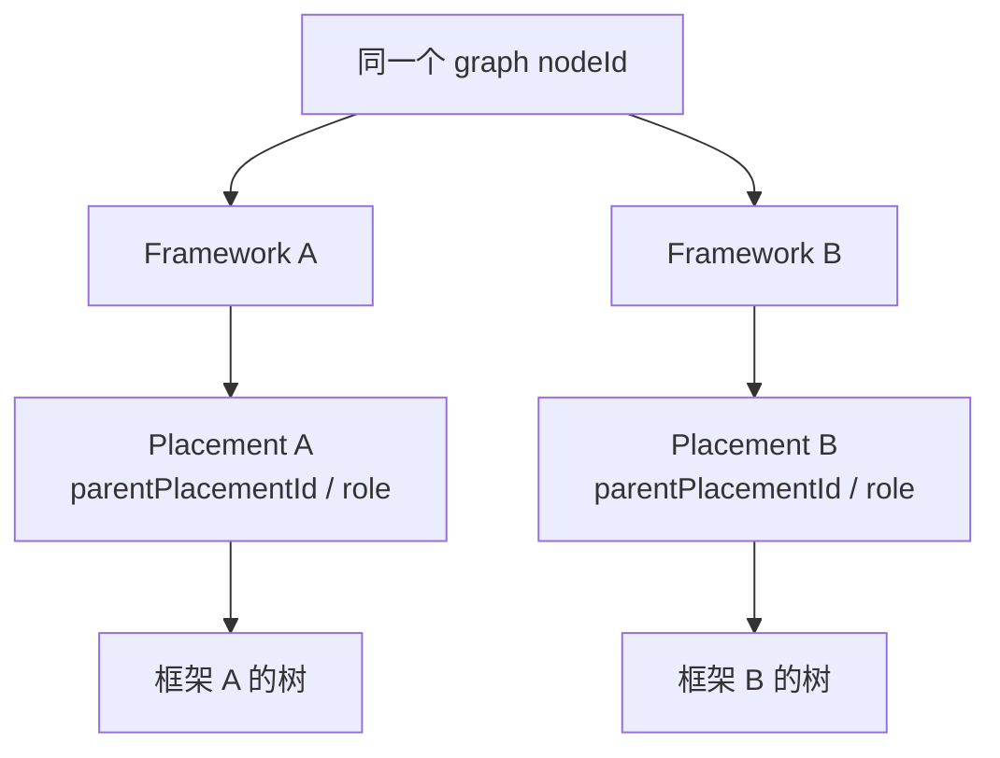
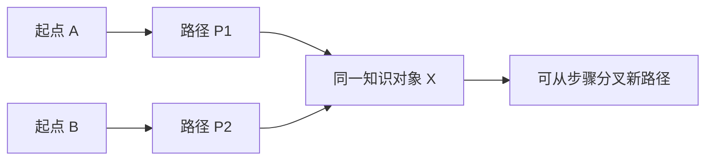
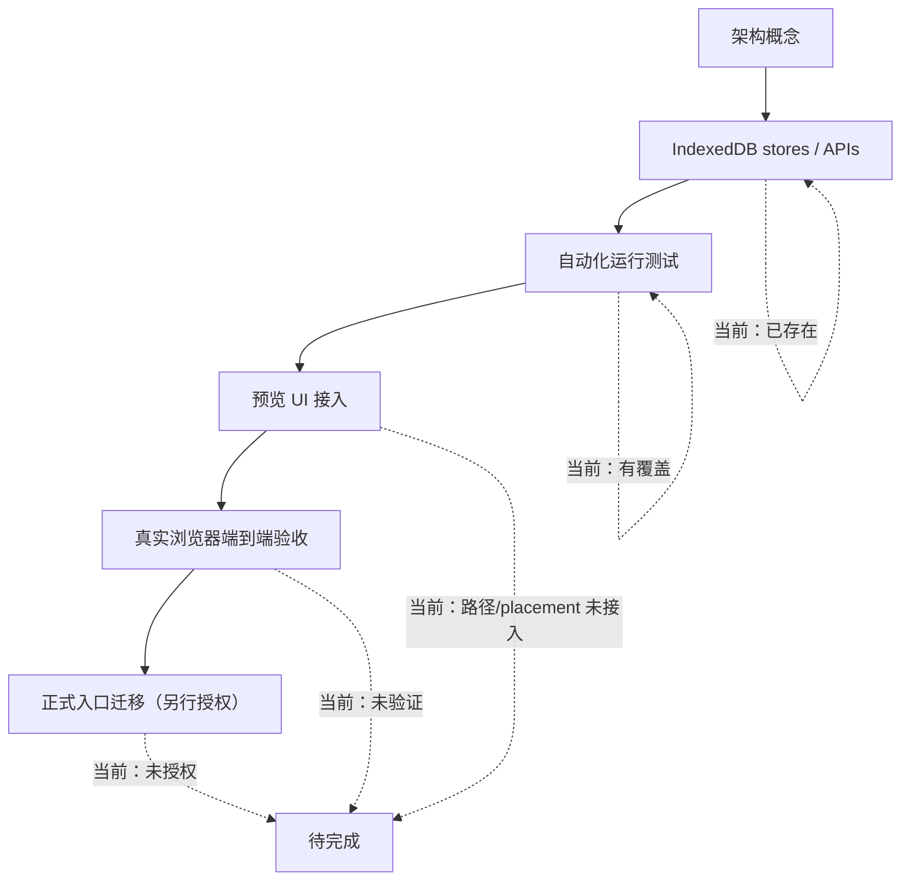

# MIND｜V3.2 数据层现状核对（阶段 B 前置审计）

**日期：2026-11-08**  
**核对对象：main 分支 `nebula-local.js`、`ui-preview-v1.html`、后台契约测试与运行测试**  
**代码基线：`nebula-local.js` SHA `912211b3d2a38b083fc7f04069afac325afdc411`；`tests/backend-runtime.test.mjs` SHA `71d0c00279061cf1d4957f95d521d969833463a3`**  
**本轮只做只读审计和文档记录，没有修改产品代码、UI 或数据库。**

> **V3.3 语义校正提示：** 本审计对“谱系/时间/空间/横向”字段及四维候选的记录，是对当时真实数据/API 的历史核对，不再代表现行产品认知模型。现行模型以中心题眼为核心，前源/左体/右用/后流四侧一体展开；框架层级、历史时点、当时世界与周围对象贯穿四侧。旧字段/API 作为现有数据兼容层保留，见 [V3.3 正式校正](MIND-V3.3-FOUR-DIRECTIONS-FOUR-DIMENSIONS-UNIFIED-MODEL.md) 与 [V3.3 实体关系规格](MIND-V3.3-ENTITY-RELATIONSHIP-AND-STATE-SPEC.md)。本提示不授权修改 schema。

## 1. 最重要的核对结果

V3.1 任务书中的“框架位置”和“探索路径”并非完全停留在概念层：当前本地数据层已经有对应 IndexedDB stores、API 和运行测试。上一份 V3.2 一致性报告将其列为阶段 B 需要定义的概念是合理的，但现在可以进一步确认：**其中一部分已有代码基础，不应重复造轮子。**

当前 `nebula-local.js`：
- `DB_VERSION = 6`。
- 已包含 `frameworkPlacements`、`explorationPaths`、`explorationSteps`。
- 完整备份 schemaVersion 为 6，并将当前 stores 纳入备份验证/恢复。
- 代码 API 已支持框架位置创建/列出/更新/删除、旧父子树迁移；探索路径创建、步骤追加、列表、分叉、快照和路径态 MindContext。

**重要边界：** API 和自动化运行测试存在，不代表正式 UI 已接入，更不代表用户真实浏览器端到端验收完成。

## 2. 已有数据层与 API 对照

| 架构概念 | 当前代码基础 | 已核实能力 | 状态 |
|---|---|---|---|
| 稳定知识对象 | `graph` 中的知识节点 ID | 多条路径引用同一 nodeId；合并时重映射相关引用并保留 original ID | 后台基础已有 |
| 框架 | `frameworks`、`frameworkVersions` | 框架及快照版本 | 后台基础已有 |
| 框架中的位置 | `frameworkPlacements` | `create/list/update/deleteFrameworkPlacement`；`parentPlacementId` 同框架校验及父子循环检查；旧图迁移 | 后台基础已有 |
| 多路径探索 | `explorationPaths`、`explorationSteps` | `createExplorationPath`、`appendExplorationStep`、`listExplorationPaths/Steps`、`forkExplorationPath`、`getExplorationPathSnapshot` | 后台基础已有 |
| 路径上下文 | `getMindContext(..., {pathId, stepId})` | 可按指定路径/步骤解析当前节点与来路 | 后台基础已有 |
| 多对多关系 | `knowledgeRelations`、`relationEvidence` | 关系类型、端点验证、关系证据引用 | 后台基础已有 |
| 节点版本 | `knowledgeVersions` | 完整语义快照、版本序号、变更理由、前序版本 | 后台基础已有 |
| AI/用户审核 | `reviewProposals` | create/update/merge/split/reparent/relation 提案及审核应用 | 后台基础已有 |
| 学习记录 | `learningRecords` | 活动记录与复习排程 | 后台基础已有 |
| 来源/原文 | `sources`、`nodeSourceLinks`、`extractionItems` 等 | 来源引用、原文定位、候选提取和关系证据 | 后台基础已有 |
| 口诀索引 | 当前以节点字段/审核提案为主 | 有口诀核验与提案能力；未核实到独立的多对多口诀索引 store/API | 部分已有 |
| 主张/解释 | 目前可在节点内容、来源和提案中保存信息 | 未核实到独立 Claim/Interpretation 实体及查询/冲突处理 API | 未独立建模 |
| 专业纠错映射 | 通用来源、提取候选和 ReviewProposal | 原文可保留、通用提案可审核；未核实到专门的 correction mapping API | 部分已有 |
| 统一回放事件 | 版本、审核、学习、过滤和路径数据分散保存 | 可作为未来回放数据源；未核实到统一 ReplayEvent store/API | 未统一 |

## 3. 已有结构如何工作

### 3.1 框架位置：知识身份与框架归属已经分开

代码中的 `frameworkPlacements` 以独立位置记录引用 `nodeId` 和 `frameworkId`，父级通过 `parentPlacementId` 指向同一框架中的另一个 placement。这样可以避免把知识对象的单一旧 `parentId` 当作所有框架中的唯一父级。

已核实的保护：
- 框架必须存在，知识节点必须存在。
- 父位置必须属于同一框架。
- 禁止对象直接成为自身位置的父级。
- 更新时检查父级循环。
- 旧图迁移为框架位置时保留原节点身份，不覆盖旧 `parentId`。
- 删除仍有子位置的 placement 会被拒绝。

### 3.2 探索路径：路径步骤身份独立于知识对象身份

已核实的保护：
- 路径起点和每一步目标必须引用已有知识节点。
- 方向严格限制为「瞻前、顾后、向内、向外」。
- 每个探索步骤有自己的 step ID；不同路径可抵达同一 nodeId，不会因此重复创建知识节点。
- 步骤可引用已有 KnowledgeRelation，且会校验关系两端与路径步进节点匹配。
- 可附带证据 ID；不存在的证据引用会被拒绝。
- 支持 parentStepId 分支、forkExplorationPath 和路径快照。
- `getMindContext` 可以根据 pathId/stepId 解析当前焦点和祖先路径。
- 节点合并时会重映射框架位置、路径根节点和步骤引用，并保留 originalNodeId/originalRootNodeId/originalFromNodeId 等来源信息。

### 3.3 测试覆盖情况

`tests/backend-runtime.test.mjs` 已覆盖：
- 同一知识对象从两条不同探索路径抵达。
- 两次抵达拥有不同 path-step ID，但共用同一 nodeId。
- 重访不重复创建知识节点。
- 从指定步骤创建分支路径。
- 缺失证据 ID 被拒绝。
- 路径态 MindContext 返回正确焦点和方向。
- 框架位置父子循环被拒绝。
- 节点合并后框架位置、路径和步骤引用重映射，同时保留原始 ID 追溯。

`tests/backend-contract.test.mjs` 检查了对应 stores 与 API 名称存在。

**测试边界：** 这是自动化代码契约和模拟 IndexedDB 运行测试，不是对用户浏览器真实数据的端到端验收。

## 4. 当前真正的缺口

### 缺口 A｜UI 尚未接入路径与框架位置 API

已核对 `ui-preview-v1.html`，其中没有调用：
- `createExplorationPath`
- `appendExplorationStep`
- `listExplorationPaths`
- `forkExplorationPath`
- `getExplorationPathSnapshot`
- `createFrameworkPlacement`
- `listFrameworkPlacements)

所以当前是“后台接口和测试存在，预览 UI 尚未接入”。不能把多路径导航或多框架位置说成用户在网站上已经可以操作的功能。正式 `index.html` 同样不能据此宣称已接入。

### 缺口 B｜主张/解释没有独立实体

节点可保存当前内容，来源和提案可留痕，但目前未核实到 Claim/Interpretation 专属 store/API。阶段 B 应先判断是否确实需要独立实体，还是可由版本化主张对象表达；不得把不同语境下的冲突观点塞进一个 desc 字段。

### 缺口 C｜专业纠错尚未形成专门映射对象

通用 ReviewProposal 可承载纠错建议，原始来源与提取片段可保全原文；但尚未核实到专门保存 rawText、candidateText、confirmedText、语境、理由、来源与用户确认状态的 correction mapping API。需要阶段 B 明确是否复用 ReviewProposal 或建立更专用的概念记录。

### 缺口 D｜口诀多对多关系未独立建模

目前可对节点做口诀核验并产生提案，但没有核实到独立的 MnemonicIndex 与多对象关联 API。不能把“某节点上有一个 mnemonic 字段”误当成已经支持一个口诀关联多个对象。

### 缺口 E｜认知回放尚无统一事件层

已有知识版本、审核提案、过滤决策、学习记录和探索路径/步骤，可作为回放来源；尚未核实到统一事件聚合 API/UI。阶段 B 要明确事件来源、时间字段和只读回放规则，不新增混淆“知识正确性”和“学习掌握度”的字段。

### 缺口 F｜四维世界上下文仍需语义类型

当前知识关系和领域上下文已有部分基础，但需要继续核实 domain、地理位置、场景、制度、文化世界之间的字段边界。领域标签不能推导空间邻近；时间标签不能自动推导因果。

## 5. 架构状态图：后台已有不等于产品已交付

## 6. 阶段 B 的正确推进顺序

1. **复用优先：** 不重建 `frameworkPlacements`、`explorationPaths`、`explorationSteps`；先核验其语义和接口边界。
2. **补充对象边界：** 决定 Claim/Interpretation、CorrectionMapping、MnemonicIndex、ReplayEvent 是否需要独立概念，先出实体关系图，不写数据库。
3. **补齐四维语义：** 对照实际字段和关系类型，区分谱系位置、历史时间、世界上下文、横向关系和画面 XYZ。
4. **UI 现状盘点：** 将“后台已存在 / UI 已接入 / 自动化已覆盖 / 浏览器已验收”分开列出。
5. **迁移评估：** 只提出兼容与回滚方案，不执行 schema 改动。

## 7. 当前结论

- **已存在且有自动化覆盖：** 框架位置、多路径探索、分叉、路径上下文、关系与证据引用、版本、审核提案、学习记录。
- **已存在但 UI 未接入：** 框架位置与探索路径相关 API（至少在当前主预览 `ui-preview-v1.html` 中未发现调用）。
- **需要进一步概念定义：** 主张/解释、专业纠错映射、口诀多对多索引、统一回放事件、空间/世界上下文的语义类型。
- **本轮未做：** UI 修改、数据库 schema 迁移、Worker 部署、正式入口改动。

**下一步应进入阶段 B 的“实体关系与状态规格”，但只先出可审阅文档，不触碰代码和数据库。**
