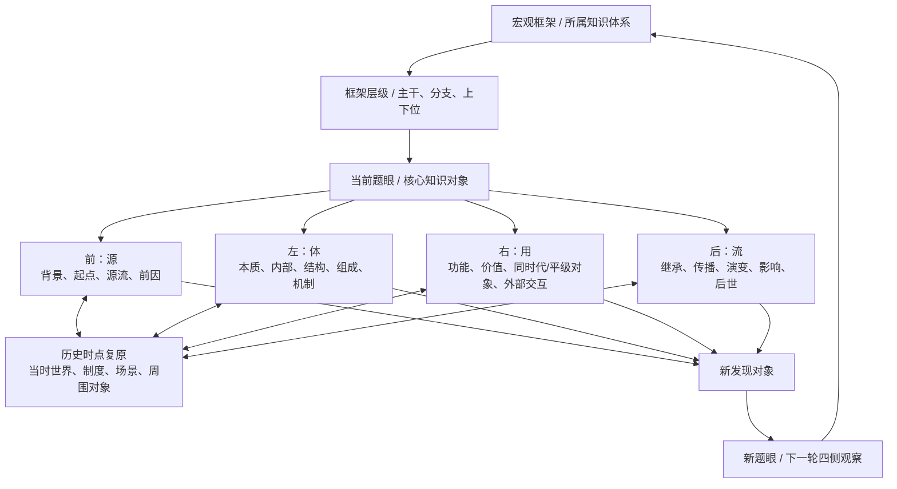
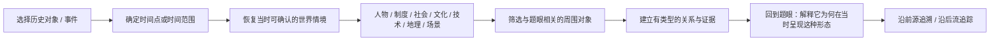
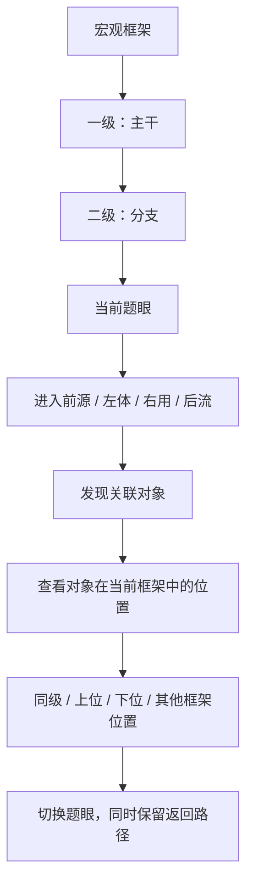
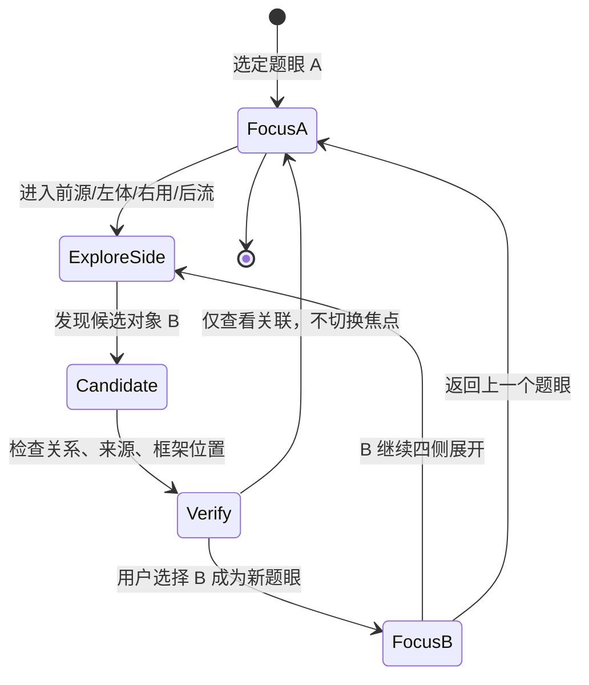

# 观复 Mind｜V3.3 A4 四侧交互语义与历史时点复原规格

**日期：2026-11-08**  
**阶段：A4｜四侧交互语义与历史时点复原**  
**依据：用户提供的「前源 / 左体 / 右用 / 后流」四向四维一体模型、元定位与口诀/树状图参考。**  
**性质：交互与认知行为规格；不构成 UI、数据库、API 或 Worker 实施授权。**

## 0. 本阶段结论

MIND 的交互中心不是“四个菜单”，而是**一个当前题眼，围绕它进行四侧观察、历史时点复原和关系追踪**。

- 题眼是当前聚焦的知识对象。
- 框架和层级说明题眼在宏观知识体系中的位置，必须在深入四侧时持续保留。
- 前源、左体、右用、后流是同一个认知模型的四个观察侧面，不是两套系统，也不是四个固定表单。
- 历史时间点、当时世界、周围人物/事件/制度、同时代与平级知识对象，是四侧观察时需要调用的上下文。
- 每个新发现的对象都可以成为新的题眼；路径要能回退，聚焦不能丢失全局。

## 1. 交互总图：题眼—框架—四侧—历史情境—关系回路



**图解：** 框架与层级先给题眼一个全局位置。四侧围绕同一题眼展开；当问题涉及历史语境时，可以从任一侧进入历史时点复原。复原后既能看当时世界，也能看对象本身和周围关系。发现的新对象可成为下一轮中心，但必须保留原题眼和进入路径。

## 2. 四侧交互定义与提问方式

### 2.1 前：源（发生学 / Why）

核心问题：**它为什么会在那个时候出现？它从哪里来？**

可展开：
- 历史传统、时代背景、制度环境、社会条件、思想环境和时代局限。
- 初始问题、底层矛盾、现实需求、触发事件和形成条件。
- 直接来源、前置人物、前置知识、制度、技术、作品与思想源流。
- 从当前题眼沿时间线向过去追溯，区分直接前因、长期背景、必要条件和后来的解释。

交互要求：
- 时间线可定位到具体事件或时间范围，不只显示孤立年份。
- 点击某个前置对象时，显示“它为什么与当前题眼有关”及关系依据。
- “更早发生”不能自动标成“导致”；没有证据时标为背景关联或待确认。
- 允许回到当时情境查看，而不是只展示一条抽象时间线。

### 2.2 左：体（本体论 / What）

核心问题：**它本身是什么？内部究竟由什么构成？**

可展开：
- 定义、边界、核心特征、关键概念和题眼。
- 组成部分、材料、结构、属性、标准、工艺、机制、主体。
- 内部各部分之间的关系、矛盾和依赖。
- 对象自身的演进：结构、范式、方法或组成如何变化。
- 与相近概念的异同、适用边界及不同解释。

交互要求：
- 从整体对象进入组成部分时，明确标识“内部组成 / 部分—整体”关系。
- 组成部分可继续成为新题眼，但保留父对象和原框架层级。
- 不把内部结构与外部关联混画成同一种关系。
- 对象的不同学派、时代或来源解释可以并存，不能强行压成唯一答案。

### 2.3 右：用（价值论 / How）

核心问题：**它对外有什么作用？处于什么世界？与谁、与什么发生联系？**

可展开：
- 功能、用途、价值、受众、适用场景、应用条件和局限。
- 同时代人物、事件、制度、作品、技术、思想和知识点。
- 同一宏观框架中的同级知识对象，以及跨分支、跨框架的对象。
- 外部世界对它的影响，以及它对外部世界的作用。
- 跨地域、学科、文化、制度、社会和技术的联系。

交互要求：
- 关联必须有明确类型，例如同时代共存、同级对照、影响、因果、应用、冲突、互补、传播、制度约束等。
- “同时代”与“同级”是发现候选对象的入口，不自动证明存在直接影响。
- 允许从当前对象切换到周围对象，但显示两者之间的关系及其证据/不确定性。
- 需要时进入当时世界视图，查看同一时点周围的人物、制度、技术、社会条件与事件。

### 2.4 后：流（发展学 / Where）

核心问题：**它后来如何发展？留下了什么影响？后世如何理解它？**

可展开：
- 已经发生的继承、传播、改造、演变、转折和后续发展。
- 后续人物、作品、制度、学科、社会与知识体系受到的影响。
- 后世的接受、批判、重释、修正和历史评价。
- 对长期知识谱系和历史进程的定位。
- 未来趋势可以出现，但必须与已经发生的历史后续分开，并明确标注预测/推测。

交互要求：
- 已发生的后续与未来预测不能混在同一事实时间线上。
- 每条影响链尽量保留中间环节和来源；不能从时间先后直接跳成因果。
- 后续对象可继续展开，保留从原题眼进入后流的路径。

## 3. 历史时点复原：从“年代标签”走向“当时世界”

用户特别强调：不是只知道它处于哪个年代，而是要能回到那个时间点，观察当时周围是什么、有哪些东西影响它。



**图解：** 复原不是生成一张想象的历史场景图，而是把有来源的时间、地点、制度、人物、事件和环境线索组织起来，再判断哪些因素确实与题眼相关。证据不足的部分必须标注未知、推测或待确认。

### 3.1 历史情境的上下文层

| 上下文 | 需要回答 | 典型信息 |
|---|---|---|
| 时间 | 当时是哪一段时间？ | 年、月、日期、时间范围、事件先后 |
| 地理与场景 | 发生在哪里、什么场景？ | 地点、区域、机构、空间场景 |
| 制度与组织 | 当时受什么制度约束？ | 法律、组织、政治制度、行业规则 |
| 社会与文化 | 当时人们处于怎样的社会文化环境？ | 阶层、习俗、价值观、社会结构 |
| 技术与物质条件 | 当时能够使用什么？ | 技术水平、工具、材料、交通、传播条件 |
| 人物与事件 | 周围有哪些关键参与者和事件？ | 人物、群体、事件、作品、决策 |
| 知识环境 | 同时代有哪些相关或平级知识？ | 学派、概念、作品、技术、学科发展 |

这些不是新的四维菜单，也不是要求每条知识全部填写的固定字段；它们是按题眼和问题需要调取的历史上下文。

### 3.2 历史复原的可信边界

- 明确区分史料记载、后世解释、研究者推断和系统生成的候选。
- 每个关键历史判断尽可能关联来源与原文定位。
- 时间精度不得超过证据支持的精度；无法确定具体日期时保留时间范围。
- 地点、制度、文化、领域和场景要区分语义，不能用一个“世界标签”混装。
- 不用现代知识或价值观直接填补当时人的认知；需要区分当时可知与后世才知。
- 史料缺失时显示未知，不以看似完整的叙事掩盖空白。

## 4. 框架与层级：四侧展开时始终保留全局锚点



**图解：** 任何一个对象都可能同时处于多个框架上下文中。进入某个对象时，不能因为切换焦点就丢掉原来题眼的位置；也不能把关系网络中的一个相邻对象自动塞成当前框架树的子节点。

必须保留：
- 当前题眼 ID。
- 当前框架及其 placement（若有）。
- 当前层级、上位路径和同级上下文。
- 当前进入侧面与来源关系。
- 从原题眼到新题眼的探索路径。
- 返回原题眼、回到框架主干和回到全局的能力。

## 5. 元定位与口诀/知识链：作为分析方法，不强制变成 UI 模板

用户提供的元定位与树状图参考应保留为 AI 认知分析方法：

### 第一步：元定位（道生一）

- 适用场域：知识点在宏观框架中的位置。
- 破题题眼：核心概念、关键词。
- 底层矛盾：题眼内最本质的矛盾，例如形神、古今、主客等，按内容具体识别。
- 语音/图片纠错：列出识别疑点、候选纠正、理由和不确定性；原始内容必须保留，用户确认后才形成正式修正。

### 第二步：知识链展开（一生万象）

- **口诀锚定：** 如果用户已有口诀，必须优先单独列出原始口诀；没有口诀时不编造，不强制要求。
- **逐字映射：** 用户要求时，对口诀每个字/词标注对应知识内容，保留原始字序。
- **逻辑展开：** 以树状结构组织本体/特征、演进/技法、价值/影响等分支；分支类别可根据知识本身变化，不限制为固定三项。
- **知识关联：** 树表达框架层级和部分—整体；跨分支、跨框架和多对多关系另行保留，不能因树状展示而丢失。

示意：

```text
【元定位】
适用场域：[宏观框架与层级]
破题题眼：[当前核心对象]
底层矛盾：[该对象最本质的张力]
语音/图片纠错：[原文、候选修正、理由、待确认]

【口诀锚定】
[用户原始口诀；若无则标注“暂无”]

【逻辑展开】
题眼
├── 本体 / 特征：[定义、组成、结构、机制]
├── 演进 / 技法：[来源、过程、方法、突破]
├── 价值 / 影响：[功能、作用、意义、后续]
└── 其他分支：[依知识内容递归展开]

【四侧一体观察】
前源：[背景、起点、前置条件]
左体：[本质、内部结构]
右用：[功能、外部对象、同时代/平级联系]
后流：[继承、演变、后续影响、后世评价]
```

**重要边界：** 上述内容是 AI 分析与知识组织方法，不代表网站必须出现代码框、固定四象限文字卡、强制 Emoji、答题模板或四个固定菜单。用户原始口诀优先于 AI 生成候选；AI 不得替用户发明“原始口诀”。

## 6. 从一个题眼切换到另一个题眼：路径与回退



**图解：** 看见一个关联对象，不等于自动切换中心。用户可以只查看关系，也可以主动将它设为新题眼。切换后保留原题眼、进入侧面、关系和返回路径；同一对象从不同路径抵达时复用稳定知识身份，不重复建节点。

### 6.1 必须区分的动作

- **查看关联：** 展示对象与当前题眼的关系，不改变当前焦点。
- **进入对象：** 用户明确选择后，将关联对象设为新题眼。
- **深入内部：** 沿左体进入组成部分，保留部分—整体关系。
- **回到来源：** 打开原始资料与证据定位，不等于切换知识对象。
- **回到历史时点：** 改变观察的历史上下文，不改变知识对象身份。
- **回到框架：** 恢复宏观框架与层级位置，不清空探索路径。

## 7. 与现有代码的映射和差距

| 交互概念 | 当前代码基础 | 当前缺口 |
|---|---|---|
| 当前题眼 | graph node / 现有焦点选择 | 需要把四侧操作统一绑定当前焦点 |
| 框架与层级 | Framework / FrameworkPlacement | 预览页未接入专用 placement API |
| 四侧探索路径 | ExplorationPath / ExplorationStep | 当前 API 使用旧方向值，需语义映射；预览 UI 未接入专用路径 API |
| 关系及证据 | KnowledgeRelation / RelationEvidence | 需要交互层展示关系类型、证据和不确定性 |
| 历史时点 | 现有来源、节点、关系与时间线能力 | 无统一 WorldContext；历史场景复原需先定义来源/证据引用规则 |
| 口诀与知识链 | AI 侧已有口诀检查/提案能力 | 无独立多对多 MnemonicIndex；不能误称已完成口诀索引 |
| 原文纠错 | Source / ExtractionItem / ReviewProposal 可部分承载 | 无专用 CorrectionMapping；原文保全和确认映射需进一步规格化 |
| 认知回放 | KnowledgeVersion / LearningRecord / ExplorationPath 可分别追踪 | 尚无统一 ReplayEvent；不可宣称已有完整回放 |

**状态必须分开汇报：** 后台已有 API、自动化测试覆盖、预览 UI 已接入、真实浏览器验收通过，是四种不同状态。当前专用框架位置与探索路径 API 在预览 UI 中尚未发现调用，真实浏览器端到端验收尚未完成。

## 8. 验收标准（A4）

1. 任何题眼都能明确展示其所属宏观框架与层级；没有确认位置时显示待定位，而不是猜测。
2. 同一题眼的四侧定义统一为前源、左体、右用、后流，不再出现旧“前瞻/左顾/右盼”作为现行模型。
3. 四侧可按需展开，不要求每个对象四侧全部有内容。
4. 进入历史时点时，可区分时间、地点、制度、社会文化、技术条件、人物事件和知识环境。
5. 历史复原内容能区分来源事实、后世解释、AI 推断和待确认内容。
6. 同时代、同级、同时空共存不被自动推断成因果或影响。
7. 关系查看和焦点切换是两个不同动作；用户可选择是否将关联对象变成新题眼。
8. 切换题眼后能返回原题眼、原框架位置和原探索路径。
9. 口诀原文优先保留；逐字映射、逻辑树是可选分析输出，不强制成为固定 UI。
10. 每个新对象都可以继续成为中心，且不会因重复访问而创建重复对象。
11. 原始资料与原始识别结果不可被 AI 候选修正静默覆盖。
12. 不改变原版视觉，不引入未经确认的四个新按钮、固定卡片或新主题。

## 9. 本轮范围与下一阶段

本轮只完成 A4 交互语义规格，不修改：
- IndexedDB schema / DB_VERSION / 用户本地数据；
- nebula-local.js 正式 API；
- index.html、ui-preview-v1.html、CSS、Three.js 场景和导航；
- DeepSeek Worker、云端服务和隐私架构。

**A4 结论：** 四侧交互的核心是同一题眼在同一框架上下文中的多面观察；历史时点复原把当时世界与周围对象带回观察现场；路径负责保留探索来路和返回能力。下一步应进入 A5 阶段架构验收，把 A1—A4 的规则逐条对照现有规范、代码与测试，列出冲突和最小缺口，再由用户决定是否进入 B 阶段实施规格。
