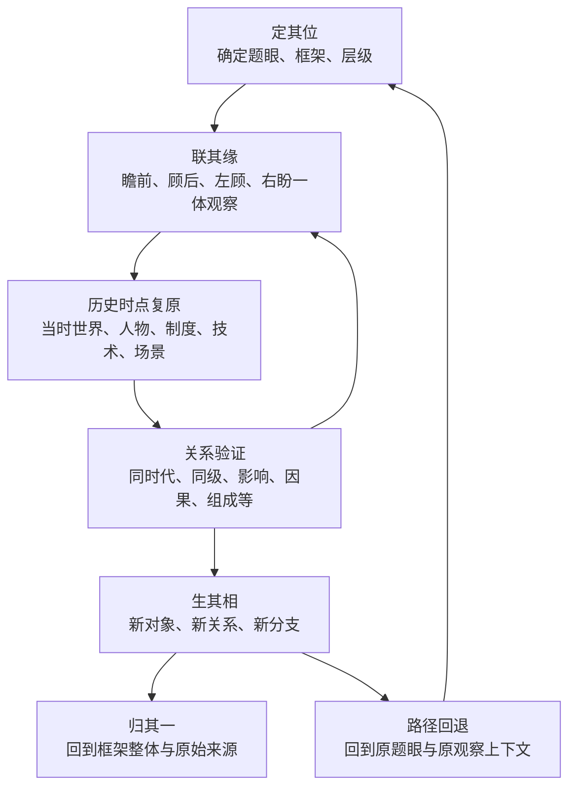

# 观复 Mind｜V3.3 A5 阶段架构验收与差异清单

**日期：2026-11-08**  
**阶段：A5｜阶段 A 架构验收**  
**核对范围：V3.3 认知模型、实体关系规格、A4 交互规格、最高设计总纲、Skill、任务书、实施蓝图、真实后台代码、自动化测试和预览 UI。**  
**本轮原则：只读核对与文档修订；不改正式代码、数据库、Worker、UI 或用户本地数据。**

## 0. 验收结论

<badge>文档语义：通过（修订后）</badge>

<badge>实施就绪：未通过</badge>

阶段 A 的产品认知定义已经能够形成闭环：

**中心题眼 → 框架与层级锚定 → 瞻前、顾后、左顾、右盼四侧一体观察 → 历史时点与当时世界复原 → 周围对象和关系验证 → 新题眼递归 → 路径回退 → 整体归纳。**

但这不代表现有网站已经实现该交互。真实代码和预览 UI 仍保留旧术语和旧布局；自动化 contract test 也有一条旧语义断言。当前只能确认“架构定义已收敛”，不能宣称“产品实现已验收”。

## 1. 阶段 A1—A4 逐项验收

| 阶段 | 核心要求 | 文档验收 | 真实实现验收 |
|---|---|---|---|
| A1 核心认知顺序 | 定其位 → 联其缘 → 生其相 → 归其一 | 通过 | 既有 AI/过滤能力部分承载；全链路待测 |
| A2 四向四维一体 | 中心题眼 + 瞻前、顾后、左顾、右盼；不再拆成两套 | 通过 | 旧方向枚举与旧 UI 尚未完成映射 |
| A3 实体关系与状态 | 稳定身份、框架位置、关系、来源、审核、路径、状态边界 | 通过（概念规格） | 已有后台基础；Claim、WorldContext 等仍有缺口 |
| A4 四侧交互与历史复原 | 四侧提问、时点复原、当时世界、周围对象、框架层级、回退 | 通过（交互规格） | 当前预览 UI 未接入路径/placement API；历史世界复原未实现 |

### A1—A4 闭环图



**图解：** 四侧不是另起一条流程，而是“联其缘”围绕同一题眼展开的四个观察面。历史时点复原是观察上下文，关系验证防止把同时代共存误判为因果；发现的新对象可成为下一轮题眼，路径则保证能回到原点和整体。

## 2. 规范文档一致性核对

### 2.1 已对齐

- V3.3 核心模型：明确四向四维是一体。
- V3.3 实体关系规格：旧方向值仅作兼容映射，不改写历史数据。
- A4 交互规格：四侧提问、历史复原、框架层级锚点、题眼切换与回退已明确。
- Skill 1.2：明确不把四向四维拆成两套按钮/字段/流程。
- 任务书 V3.1：旧拆分内容有 V3.3 覆盖提示，现行章节已改为四侧一体。
- 最高设计总纲：本轮将残留的“前者负责生发、后者负责全局”拆分句修订为历史术语记录，并明确现行一体定义。

### 2.2 仍保留的历史记录，不能误当现行定义

- V3.1 原始审议记录仍保留当时“03 new 四维定位”的历史决策；V3.3 只覆盖其错误的拆分解释，不抹除审议历史。
- V3.2 架构审查中的“四向 × 四维正交图”保留为历史记录。
- 旧代码中的方向值“瞻前、顾后、向内、向外”保留作兼容值，需映射到瞻前、顾后、左顾、右盼。
- 旧实施蓝图的“谱系/时间/空间/横向”字段说明属于历史工程审计，不是当前产品的独立四维定义。

## 3. 真实代码与 UI 的关键差异

### 3.1 后台已有，但不代表网页可操作

当前 `nebula-local.js` 的 DB_VERSION 为 6，已存在：
- `frameworkPlacements`、`explorationPaths`、`explorationSteps` stores；
- `createFrameworkPlacement`、`listFrameworkPlacements`、`createExplorationPath`、`appendExplorationStep`、`forkExplorationPath`、`getMindContext` 等 API；
- 运行时测试覆盖多框架位置、同一知识对象从多路径抵达、路径分叉、关系/证据引用校验、框架父子循环拒绝等行为。

### 3.2 预览 UI 仍明显是旧模型

在 `ui-preview-v1.html` 中仍能检索到：
- 右侧 “FOUR DIRECTIONS” 列表使用“前瞻、顾后、左顾、右盼”；
- 另一个 “continuum” 区域把四个象限标为“谱系纵向、时间维度、空间世界、横向关联”；
- 中心文案仍把它们解释成四个独立维度/方向区域；
- 页面未检索到 `createExplorationPath`、`appendExplorationStep`、`listExplorationPaths`、`forkExplorationPath`、`createFrameworkPlacement`、`listFrameworkPlacements` 专用 API 调用。

**判断：** 这不是简单改四个标签就能完成的任务。旧 UI 的语义结构本身仍然拆分，需要在架构验收后重新定义交互映射；但视觉 old 决议仍然有效，不得借机重做主题、中心主视觉、节点样式或导航。

### 3.3 自动化测试存在旧语义断言

`tests/backend-contract.test.mjs` 中存在如下断言：

```js
assert.ok(
  charter.includes("四向探索模型") && charter.includes("四维定位模型"),
  "Exploration directions and global dimensions must remain separate."
);
```

这条断言的错误在于测试说明仍要求“四向与四维分开”。本轮最高设计总纲已修订为一体定义，同时保留两个旧术语作为历史名词，因此当前字符串断言可能仍通过，但它**没有真正验证语义**，属于失效的契约测试。

后续经用户授权修改测试时，应改为检查：
- charter 明确包含“四向四维是一体”的现行定义；
- 包含“瞻前、顾后、左顾、右盼”四侧；
- 不再包含“负责生发 / 负责全局”作为两套独立系统的定义；
- 保留稳定身份、多路径和多框架位置等原有约束。

本轮没有修改测试代码，因此不宣称这一问题已经修复。

### 3.4 实施蓝图有一处版本快照过期

`docs/GUANFU-MIND-IMPLEMENTATION-BLUEPRINT.md` 的历史审计段落仍写 `DB_VERSION = 5`，而当前真实 `nebula-local.js` 已是 `DB_VERSION = 6`。该段落有“历史快照”说明，但其标题/措辞仍容易被误读为当前状态。

后续应把该段明确标为 2026-11-07 的历史快照，或另加当前代码核验结果；不得据此回退数据库版本或执行迁移。

## 4. 后台、测试、UI、浏览器验收四种状态分开

| 能力 | 后台存在 | 自动化覆盖 | 预览 UI 接入 | 真实浏览器验收 |
|---|---|---|---|---|
| 稳定知识节点 | 有 | 有基础覆盖 | 有既有节点视图 | 未完成全量验收 |
| 多框架位置 | 有 API/store | 有多位置、父子循环测试 | 未发现专用 API 调用 | 未完成 |
| 多路径探索 | 有 API/store | 有同对象多路径、分叉、路径上下文测试 | 未发现专用 API 调用 | 未完成 |
| 关系与证据 | 有 API/store | 有运行时覆盖 | 部分既有关系显示，需逐项核对 | 未完成 |
| 四侧一体认知交互 | 仅有旧方向路径基础 | 测试仍使用旧方向值 | 旧 UI 语义 | 未开始 |
| 历史时点复原 | 无统一 WorldContext | 无完整复原测试 | 旧时间线展示 | 未开始 |
| 口诀多对多索引 | 无独立实体 | 无独立索引测试 | 有口诀 AI 检查，不等于索引 UI | 未开始 |
| 统一认知回放 | 无统一 ReplayEvent | 无统一事件测试 | 旧时间线不等于回放 | 未开始 |

## 5. A5 验收判定与阻塞项

### 已通过
1. 现行产品语义已统一为中心题眼 + 四侧一体。
2. 框架与层级贯穿四侧，不再独立成为第二套四维系统。
3. 历史时点复原、当时世界、周围对象与同时代/平级关联有明确边界。
4. 树、关系网络、探索路径、来源和对象身份的职责已分开。
5. 口诀与树状知识链作为分析方法保留，不强制照搬为 UI 模板。
6. 原版视觉、local-first 隐私与 later 暂缓决定没有被本轮改动。

### 尚未通过（进入工程实施前必须处理）
1. **旧 UI 语义：** 预览页仍存在旧四向标签与独立四维象限。
2. **契约测试：** backend-contract.test.mjs 仍以旧拆分语义作为断言目标。
3. **历史时点数据：** 尚无统一 WorldContext；需先确定最小上下文、来源和证据模型。
4. **方向兼容：** 现有路径 direction 枚举需制定非破坏性兼容策略。
5. **浏览器验收：** 框架位置与多路径 API 尚未在当前预览 UI 完整接入和端到端测试。

## 6. 阶段 A 的最终门槛

阶段 A 可以判定为**文档与概念层通过**，但不能判定为**产品实现层通过**。

进入阶段 B 前应先明确最小实施边界：
- 先处理旧方向枚举的兼容映射；
- 先确定历史时点复原需要的最小上下文和证据引用；
- 先制定 UI 交互规格映射，但不先改视觉；
- 修正过时的契约测试语义；
- 明确框架位置/路径 API 的前端接入与验收计划。

任何 schema、正式代码、UI 或 Worker 修改仍须另行授权；不自动启动。

## 7. 下一阶段建议

**阶段 B0：最小兼容与交互实施方案**，先出方案，不直接编码：

1. 旧 direction 值到四侧一体语义的映射与备份兼容。
2. WorldContext 最小概念：时间范围、地点/场景、制度/社会/文化/技术上下文、来源证据；明确哪些可选、哪些未知。
3. 关系候选的类型清单：前置来源、内部组成、同时代共存、同级对照、影响、因果、传播、继承、冲突、互补等。
4. 题眼切换、仅查看关联、回到来源、回到历史时点、回到框架和回退路径的交互状态。
5. 测试更新清单和真实浏览器验收用例。

**本文件结论：** 认知架构已收敛，现有后台基础可复用，但当前 UI 与一条自动化契约测试仍在表达旧模型。下一步应先制定阶段 B0 兼容与实施方案，不能直接把当前 UI 当成已符合 V3.3。
