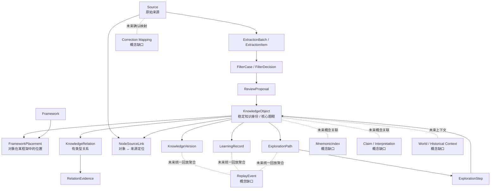
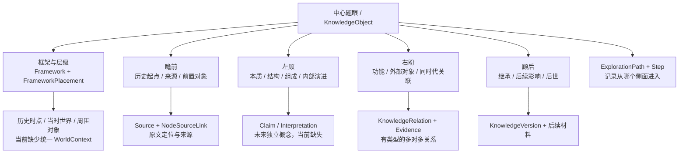
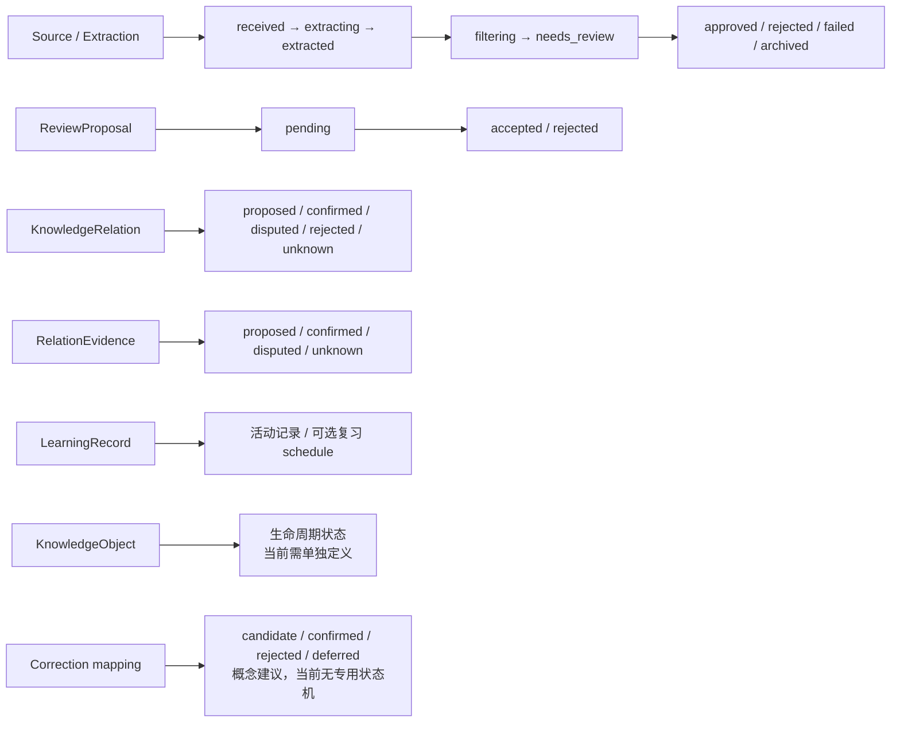

# MIND｜V3.3 阶段 B 实体关系与状态规格（概念草案）

**日期：2026-11-08**  
**依据：V3.3《四向四维一体模型正式校正》及真实代码核对**  
**性质：数据与交互规格；不构成数据库 schema、迁移、UI 或正式代码实施授权。**

## 1. 核心校准

中心知识点（题眼）是当前认知焦点；框架及层级说明它在宏观知识体系中的位置。围绕同一题眼，以「瞻前、顾后、左顾、右盼」四侧一体展开。历史时间、具体时点、当时世界、周围对象和关系证据，是四侧观察时使用的上下文，不再建成另一套独立“四维定位”模型。

旧代码的探索路径 API 仍使用“瞻前 / 顾后 / 向内 / 向外”四个方向值。概念映射如下：

| 旧 API 方向值 | V3.3 一体模型语义 |
|---|---|
| 瞻前 | 瞻前——来源、历史背景、起点、前因 |
| 向内 | 左顾——对象本身、本质、组成、结构 |
| 向外 | 右盼——功能、外部世界、同时代及跨界关联 |
| 顾后 | 顾后——已发生的继承、演变、影响与后世 |

这只是规格层兼容映射，不代表已修改 API、现有路径数据或数据库字段。未来若统一存储枚举，必须保留旧值映射与原始路径上下文，不得破坏性改写历史数据。

## 2. 总体概念关系图



**图解：** 已有实体承担稳定对象、框架位置、关系、来源、提取、审核、版本、路径和学习记录。Claim/Interpretation、WorldContext、CorrectionMapping、MnemonicIndex、ReplayEvent 是需要明确的概念缺口；不能因为图上出现概念名称，就误认为数据库中已经有对应 store 或 API。

## 3. 真实代码现状：已有、部分承载、缺失

核对文件：nebula-local.js、tests/backend-runtime.test.mjs、tests/backend-contract.test.mjs、ui-preview-v1.html。

当前 nebula-local.js 声明 DB_VERSION = 6，IndexedDB store 清单包含：

```text
graph, references, lectureSources, aiConversations, assets, meta, history,
sources, nodeSourceLinks, knowledgeVersions, reviewProposals, learningRecords,
researchSessions, knowledgeRelations, extractionBatches, extractionItems,
filterCases, filterDecisions, frameworks, frameworkVersions, nodePositions,
relationEvidence, frameworkPlacements, explorationPaths, explorationSteps
```

### 3.1 实体映射

| 概念 | 真实代码承载 | 当前状态 | 边界 / 缺口 |
|---|---|---|---|
| KnowledgeObject | graph 中的 nodes[] | 已有 | 节点 ID 是当前稳定引用；不是独立 object store |
| Framework | frameworks | 已有 | 有框架记录与 rootNodeIds |
| FrameworkPlacement | frameworkPlacements | 已有 | 有 frameworkId、nodeId、parentPlacementId 等上下文位置字段 |
| KnowledgeRelation | knowledgeRelations | 已有 | 有 sourceNodeId、targetNodeId、relationType、status 等 |
| RelationEvidence | relationEvidence | 已有 | 独立记录关系证据及审核状态 |
| ExplorationPath | explorationPaths | 已有 | 有 rootNodeId、frameworkId、parentPathId、currentStepId 等 |
| ExplorationStep | explorationSteps | 已有 | 有 pathId、fromNodeId、toNodeId、direction、parentStepId 等 |
| Source | sources | 已有 | 有来源类型与来源元数据 |
| NodeSourceLink | nodeSourceLinks | 已有 | 节点到来源的可追溯链接，可携带 evidenceLocator |
| ExtractionBatch / Item | extractionBatches / extractionItems | 已有 | 原始来源与提取候选分开 |
| FilterCase / Decision | filterCases / filterDecisions | 已有 | 有阶段状态与追加式用户决策 |
| KnowledgeVersion | knowledgeVersions | 已有 | 保存节点完整快照、版本号、变更原因和 supersedesVersionId |
| ReviewProposal | reviewProposals | 已有 | 通用 create/update/merge/split/reparent/relation 提案及审核状态 |
| LearningRecord | learningRecords | 已有 | 记录学习活动；部分活动产生复习 schedule |
| Claim / Interpretation | 无独立 store/API | 缺失 | 不同来源、学派、时代的解释不能被覆盖进唯一摘要 |
| WorldContext | 无独立 store/API | 缺失 | 现有框架 context 或建议字段不能自动视为规范化世界/历史场景实体 |
| CorrectionMapping | 无专用 store/API | 部分承载 | 通用 ReviewProposal 可保存候选修正，但无专门原文↔确认修正映射生命周期 |
| MnemonicIndex | 无独立 store/API | 缺失 | 口诀检查与 ReviewProposal 候选，不等于口诀多对多索引 |
| ReplayEvent | 无统一 store/API | 缺失 | 版本、路径、审核、学习记录可分别追踪，尚无统一事件模型 |

### 3.2 关键代码行为已确认

- createFrameworkPlacement 校验框架和知识节点存在；父位置必须属于同一框架，并检查自我父级等约束。位置记录包含 frameworkId、nodeId、parentPlacementId、placementType、needsReview 等字段。
- createExplorationPath 校验根节点、可选框架和父路径；appendExplorationStep 校验方向、起点/终点、父步骤和可选关系/证据引用。
- forkExplorationPath 从指定路径步骤分叉；不同路径步骤可以指向同一 nodeId，不会因此重复创建知识对象。
- getMindContext 支持按 pathId / stepId 恢复当前焦点与路径上下文；旧路径之外的 legacy context 仍会读取旧 parentId 链。
- saveKnowledgeRelation 支持有类型关系及 proposed / confirmed / disputed / rejected / unknown 状态；确认关系要求记录 confirmedBy。
- createRelationEvidence 支持 proposed / confirmed / disputed / unknown 证据状态。
- createKnowledgeProposal 只创建 pending 提案；applyKnowledgeProposal 需明确 accept/reject，接受后才修改正式知识。
- saveNodeVersion 保存节点语义字段完整快照；saveLearningRecord 记录学习活动和部分复习调度。
- 备份导出/恢复覆盖完整 store 集合；schemaVersion 6 是当前代码版本，不代表已通过真实用户设备的数据恢复验收。

## 4. 四侧一体模型在实体层如何承载



**图解：** 四侧不是四个互斥的知识对象类型，而是同一知识对象的观察与展开方式。前侧优先关联来源与前置对象；左侧分析对象自身；右侧建立外部有类型关系；后侧关联后续材料、版本与后世解释。任何一侧都可能引用多个来源、多个关系或多个探索路径。框架位置贯穿四侧；历史时点和当时世界是上下文，不应仅靠 XYZ 坐标表达。

## 5. 核心概念实体规格（目标态建议，非 schema）

### 5.1 KnowledgeObject
- 稳定 id；名称、别名、对象类型、当前用户认可摘要/题眼、生命周期状态。
- 当前正式内容可继续由 graph node 承载，避免立即重复建立第二份对象主记录。
- 身份不得由标题、路径、坐标或单一框架位置生成。
- 多来源、多解释、多框架位置均可指向同一稳定 ID。

### 5.2 Framework / FrameworkPlacement
- Framework 表示一套宏观知识框架。
- FrameworkPlacement 表示某知识对象在某个框架上下文中的位置。
- 同一对象可以有多个 placement；每个 placement 可有自己的 parent placement、role、context、排序、审核状态。
- 不得把 node.parentId 当作所有框架的全局唯一父级。
- 已有字段可继续复用；不因四侧模型校正而重做框架树。

### 5.3 Claim / Interpretation（待补充概念）
- 记录某个主体/来源在特定语境和时间范围内对知识对象提出的解释、判断或主张。
- 概念上区分提出者、内容、适用语境、时间范围、来源引用、主张状态、与其他主张的支持/冲突/修正关系。
- 不同学派或时代解释不得因同属一个对象而合并成唯一描述。
- 不应在本轮直接添加 store；先确定用户是否需要独立主张实体及其审核流程。

### 5.4 WorldContext（待补充概念）
- 表达历史时点复原所需上下文：时间范围、地理地点、场景、制度、社会、文化、技术、知识领域等。
- 各属性必须标明语义类型；知识领域不能当成地理位置。
- 可被多个知识对象、关系、主张和路径步骤引用。
- 不把“同一时代/同一地点/同一领域”自动转成因果关系。
- 瞻前用于重建起点背景；右盼用于观察同时代外部对象；顾后用于比较后续世界变化。

### 5.5 CorrectionProposal / CorrectionMapping（待补充概念）
- 原始识别文本和定位永久保留。
- AI 可产生候选修正、理由、来源与不确定性；用户确认后产生可追溯的原文↔确认修正映射。
- 通用 ReviewProposal 可继续承载候选阶段；确认映射是否需要独立记录，应在规格评审后决定。
- 不得将未经确认的修正覆盖回原始文件或转写。

### 5.6 MnemonicIndex（待补充概念）
- 口诀作为独立可选索引，与 KnowledgeObject 多对多关联。
- 需区分用户原始口诀、AI 候选、用户确认版本及逐字/分段语义映射。
- 当前 checkMnemonic / proposeMnemonicReview 是 AI 检查与提案能力，不是独立口诀索引实体。
- 不强制每个对象有口诀；相似口诀不得自动合并知识。

### 5.7 ReplayEvent（待补充概念）
- 统一回放未来可聚合的事件：来源导入、提取、过滤决策、审核、对象版本、框架位置变化、关系确认、探索路径步骤、学习活动。
- 必须保留事件类型、发生时间、涉及对象、操作者、来源/证据、前后状态摘要。
- 历史事件发生时间、知识所处历史时间、用户学习时间必须分开。
- 回放默认只读；恢复旧版本仍需用户明确执行。
- 当前不创建统一 ReplayEvent store；先验证现有事件可否可靠重建以及是否存在丢失窗口。

## 6. 状态域：禁止混成一个 status



### 6.1 已有状态事实

**来源/提取与过滤状态**：代码中的 FILTER_STATUSES 为 received、extracting、extracted、filtering、needs_review、approved、rejected、failed、archived，并有显式允许转移表。该状态机用于过滤/提取记录，不等于知识对象生命周期。

**审核提案状态**：ReviewProposal 创建时为 pending；当前应用接口接受 accept 或 reject，分别落为 accepted 或 rejected。不能把“AI 生成候选”描述成已接受知识。

**关系状态**：proposed、confirmed、disputed、rejected、unknown。关系确认必须记录确认者。

**关系证据状态**：proposed、confirmed、disputed、unknown。证据状态不等于关系状态。

**学习状态**：LearningRecord 保存 activityType、quality/score 等学习活动字段；部分 recall/quiz/mnemonic/flashcard 类活动会产生 schedule。它表示用户学习行为或复习调度，不代表知识事实正确。

### 6.2 需要后续定义但本轮不实施

- KnowledgeObject 生命周期：active / under_revision / archived 等是否足够，需先梳理当前 graph node 字段和旧数据。
- Claim 状态：proposed / accepted / disputed / superseded 等需结合来源和语境定义。
- CorrectionMapping 状态：candidate / confirmed / rejected / deferred，且保留原文。
- WorldContext 的时间精度、地点粒度和制度/文化语境的引用规则。
- ReplayEvent 的幂等键、事件来源、补录策略及隐私/备份行为。

## 7. 现有测试覆盖与 UI 接入状态

| 能力 | 后台 API / store | 自动化测试 | 当前预览 UI | 真实浏览器验收 |
|---|---|---|---|---|
| 框架位置 | 已有 | 有父子循环、旧数据迁移相关测试 | 尚未证实接入专用 API | 未完成 |
| 多路径探索 | 已有 | 有多路径同对象、步骤唯一 ID、分叉、证据校验、MindContext 测试 | 搜索不到专用 API 调用 | 未完成 |
| 关系与证据 | 已有 | 有 API contract 与运行时相关覆盖 | 部分既有 UI 能力需另核对 | 未完成 |
| 来源与提取 | 已有 | 有来源、提取、定位和迁移测试 | 已有部分导入流程调用 | 未完成全格式验收 |
| ReviewProposal | 已有 | 有审核和提案处理覆盖 | 有部分过滤审核流程 | 未完成 |
| Claim / WorldContext | 缺失 | 无 | 无 | 未开始 |
| CorrectionMapping | 无专用实体/API | 只有通用审核能力覆盖 | 未证实 | 未开始 |
| MnemonicIndex | 缺失 | 无独立索引测试 | 口诀检查/提案不等于索引 UI | 未开始 |
| ReplayEvent | 缺失 | 无统一事件层测试 | 无 | 未开始 |

**关键限制：** ui-preview-v1.html 当前未发现 createExplorationPath、appendExplorationStep、listExplorationPaths、forkExplorationPath、createFrameworkPlacement、listFrameworkPlacements 等专用 API 调用。因此，后台接口存在不代表用户在网页上已经可以操作这些功能。

## 8. 建议推进顺序

1. 先冻结语义：中心题眼、框架层级、瞻前、顾后、左顾、右盼一体模型及历史时点复原。
2. 优先复用已有实体：graph node、FrameworkPlacement、KnowledgeRelation、Source、ReviewProposal、KnowledgeVersion、ExplorationPath/Step。
3. 先写清楚缺口：Claim/Interpretation、WorldContext、CorrectionMapping、MnemonicIndex、ReplayEvent 的业务边界和是否必要。
4. 先做交互规格，不做 UI：明确如何从题眼进入四侧、如何回到历史时点、如何看当时世界与周围对象、如何保留框架层级和返回路径。
5. 再做数据迁移评估：旧方向枚举映射、现有字段复用、备份兼容、幂等和回滚。
6. 待用户审阅并单独授权后，才修改 schema、API、UI 或 Worker。

## 9. 明确不在本轮范围

- 不修改 DB_VERSION、IndexedDB stores 或已有用户数据。
- 不新建 Claim、WorldContext、CorrectionMapping、MnemonicIndex、ReplayEvent store。
- 不改写旧路径方向枚举或迁移历史数据。
- 不修改 index.html、ui-preview-v1.html、CSS、Three.js 场景或导航。
- 不修改 Worker、云服务或隐私架构。
- 不启动 UI 设计；原版视觉 old 保持不变。
- 不启动第 10 项独立证据可靠性体系（later）。

**本规格结论：** 现有后台已具备稳定知识节点、框架位置、多路径探索、关系证据、来源、审核、版本和学习记录等基础；四侧一体模型主要需要先统一语义与上下文引用，不能通过简单增加第二套“四维字段”解决。下一步应优先制定交互语义与缺失概念规格，再评估最小数据补充。
