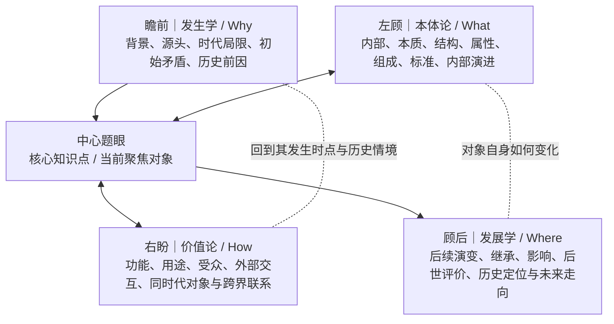
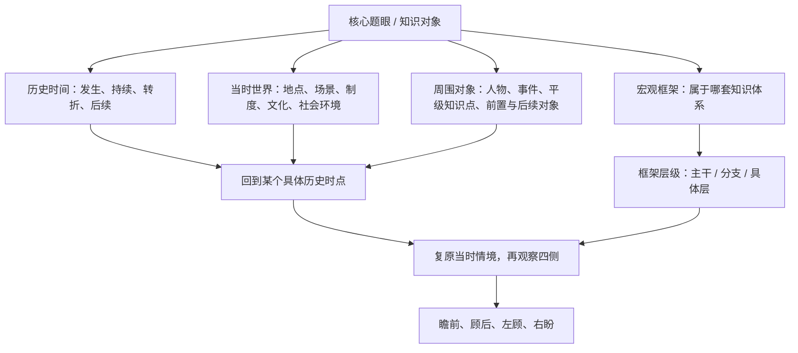
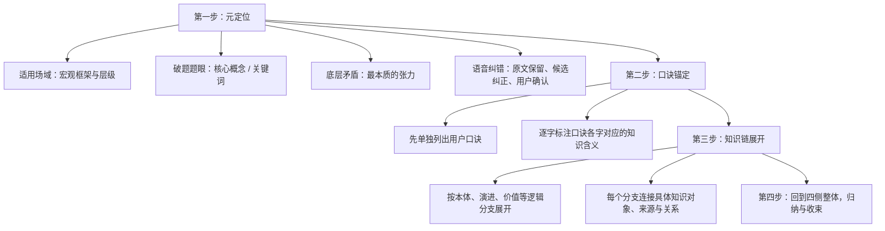

# 观复 Mind｜V3.3「四向四维一体」核心认知模型正式校正

**日期：2026-11-08**  
**性质：用户明确纠正后的正式架构校正；优先级高于 V3.1 中对“四向探索 / 四维定位”的拆分表述。**  
**范围：只校准认知模型、术语和架构文档；不修改 UI、正式代码、数据库、Worker 或用户数据。**

## 0. 校正结论

此前将“四向探索”和“四维定位”拆成两个独立系统，是对用户原意的错误理解，现正式撤销这种拆分。

**四向与四维是一体的同一个认知观察模型。** 它不是先做四维定位、再启动另一套四向探索，也不是两组彼此独立的按钮、字段或流程。

正确结构是：

1. 先找到一个具体知识核心点，即题眼。
2. 明确这个点在宏观知识框架中的位置、所属框架及层级。
3. 以这个核心点为中心，沿「瞻前、顾后、左顾、右盼」四个侧面同时观察。
4. 在观察每一侧时，结合它所处的历史时间、当时世界/场景、框架上下文及周围对象，必要时回到具体历史时点重建当时情境。
5. 由此展开关联、结构、知识链和整体归纳。

中心点是观察锚点；框架与层级是贯穿四侧的定位上下文；四侧共同构成一个整体认知模型。

## 1. 核心结构：中心题眼 + 四侧一体展开

**图解：** 中心始终是当前题眼。前、后主要沿时间线观察来源与后续；左、右主要观察对象内部本质与外部世界。四侧不是四个孤立栏目，而是围绕同一个知识点互相校验、互相补充的观察面。

## 2. 四侧统一定义

### 瞻前（发生学 / Why）

回答：它从哪里来？为什么在那个时点出现？

- 背景：历史传统、时代条件、制度环境、思想环境及当时局限。
- 起点：最初的问题、矛盾、需求、触发事件或形成条件。
- 源流：前置人物、知识、事件、制度、技术和思想来源。
- 历史回溯：可沿世界时间线向过去追溯，并区分直接来源、背景条件和后来的解释。
- 时点复原：必要时回到具体历史时间点，重建当时的场景、参与者、制度与可用条件。

### 左顾（本体论 / What）

回答：它本身是什么？内部由什么构成？

- 内部：定义、边界、结构、组成、材料、属性、标准、机制和主体。
- 本质：核心特征、关键概念、题眼及底层矛盾。
- 演进：对象内部结构、范式、方法或组成部分如何变化、突破。
- 辨析：与相近概念的区别、适用边界和内部张力。

### 右盼（价值论 / How）

回答：它对外如何发生作用？与谁、与什么世界发生联系？

- 外部：功能、用途、价值、受众、适用场景和外部条件。
- 关联：同时代人物、事件、制度、作品、知识点及平级对象。
- 交互：它如何影响外部对象，又受到哪些对象影响；关系类型需要具体说明。
- 跨界：跨地域、学科、文化、制度、技术、社会和知识框架的联系。
- 时空环境：观察它在当时处于怎样的世界、场景和关系网络中。

**重要：** 同时代、同地域或同领域只能作为寻找关联的线索，不能自动证明存在影响、因果或直接关系；关系需要来源、理由或待确认标记。

### 顾后（发展学 / Where）

回答：它后来流向哪里？留下什么后续？

- 走向：已经发生的继承、传播、变化、发展、转折和新范式。
- 影响：对后续人物、制度、学科、作品、社会或知识体系的影响。
- 后世：后世如何评价、接受、批判、改造或重新解释。
- 历史定位：它在长期发展中的位置、意义和质变。
- 未来：可另列趋势、可能走向或预测，但必须标明是推测，不得与已经发生的历史后续混写。

## 3. 框架位置与历史时空：贯穿四侧，不另立一套四维系统

**图解：**

- **框架与层级：** 先知道“我现在看的是哪一个知识点，它在什么宏观框架、哪一层”。四侧展开时始终保留这个上下文，不允许深入后丢失全局位置。
- **时间线：** 不只是给对象贴一个年代，而是可以回到其发生、发展或转折的具体时点，分别查看前因、当时条件和后来影响。
- **当时世界：** 不只看地点，还包括当时制度、社会、文化、技术、思想和场景。不同语义应分别记录，不能把知识领域标签当成地理位置。
- **周围对象：** 找出影响它、被它影响、与它同时代或处于同一层级的对象；同时代/平级关系与因果关系必须区分。
- **四侧联动：** 回到某个历史时点后，既看它本身的内部结构，也看当时周围世界，再沿时间向前追溯来源、向后追踪后续。

## 4. 与现行最高法则的关系

本次校正不替换现行最高法则：

**定其位 → 联其缘 → 生其相 → 归其一**

四向四维一体模型是其中围绕核心题眼进行定位、关联和展开的认知结构，不是另一套与最高法则并列的操作流程。

- **定其位：** 找到题眼，确定它属于哪个宏观框架、哪一层。
- **联其缘：** 以四侧一体观察，建立历史来源、内部构成、外部关联和后续流变。
- **生其相：** 将这些关系组织成可理解的知识结构、知识链和多层展开。
- **归其一：** 回到核心题眼，形成整体解释与认知收束。

## 5. 口诀与知识链：作为展开后的压缩索引

用户给出的口诀和树状图参考应保留为知识组织方法，而不是被误做成固定网站 UI 模板。

**图解：** 先定位知识点和题眼，再单独呈现口诀；随后按口诀各字展开知识链，并将分支连接到具体知识对象。口诀是用户可选的压缩索引，不强制生成、不替代原始资料和完整推理，也不因口诀相似而自动合并知识对象。

## 6. 树状知识链参考的保留原则

用户提供的知识链格式是认知分析与知识整理的参考结构，保留其高层方法：

- 元定位：适用场域、题眼、底层矛盾、语音纠错。
- 口诀锚定：必须先单独列出用户已有口诀；没有口诀时明确标注“暂无”，不得擅自编造为用户口诀。
- 逻辑展开：按口诀字义或知识逻辑分支展开，并标注每个字对应的内容。
- 分支内容：每个分支应连接概念、现象、问题、发展、突破、对策、意义、地位等具体知识。
- 四侧观察：瞻前、顾后、左顾、右盼共同支撑知识链，不强迫所有知识都塞入固定三分支。
- 归纳收束：回到题眼和底层矛盾，说明各分支如何共同解释核心问题。

**边界：** 这是知识分析方法参考，不是要求把代码框、Emoji、固定模板、口诀栏或答题模板原样复制到网站界面。视觉与交互仍遵循原版视觉 old，UI 改动须另行确认。

## 7. 对此前 V3.1 / V3.2 文档的正式纠正

以下旧表述从本次校正起不再作为有效产品定义：

1. “四向是探索行为、四维是独立全局坐标语义，两者必须严格分层”的拆分结论。
2. 将谱系、时间、空间/世界、横向关联规定为与四向并列的另一组四维系统。
3. 将四向和四维设计成两组独立入口、按钮或必填字段。
4. 将四向四维的关系仅解释为正交的两层模型。

保留仍然有效的内容：

- 稳定知识身份、框架树、关系网络和三维地图之间的边界。
- 框架位置必须带框架上下文；同一知识对象可在多个框架中出现。
- 历史时间、当时世界、人物事件与平级知识对象要能关联。
- 路径与知识对象分离；AI 只提出建议，正式变更由用户确认。
- 原始资料保全、专业纠错、口诀可选与多对多索引。
- 第 10 项独立证据可靠性体系仍为 later。
- 原版视觉 old；本次不启动 UI 设计或修改。

## 8. 下一步架构工作

在本模型基础上继续阶段 A / B 前置规格：

1. 把中心题眼、框架与层级、瞻前、顾后、左顾、右盼、历史时点复原、周围对象与知识链关系，写入统一实体关系规格。
2. 对照真实数据层，检查哪些字段/API已有，哪些只是概念缺口；不能凭文档假定已实现。
3. 明确四侧展开结果如何关联同一个稳定知识对象、不同来源、关系和探索路径。
4. 保留用户口诀与 AI 候选的区别及逐字映射关系。
5. 本阶段只写规格和图解，不修改数据库、代码、UI 或 Worker；后续实施另行授权。

**最终定义：一个题眼作为核心定位点，框架与层级作为全局上下文，瞻前、顾后、左顾、右盼四侧合为一个四向四维认知模型；回到历史时点复原当时世界，并观察其内在本质、外部关联、来源与后续流变。**
