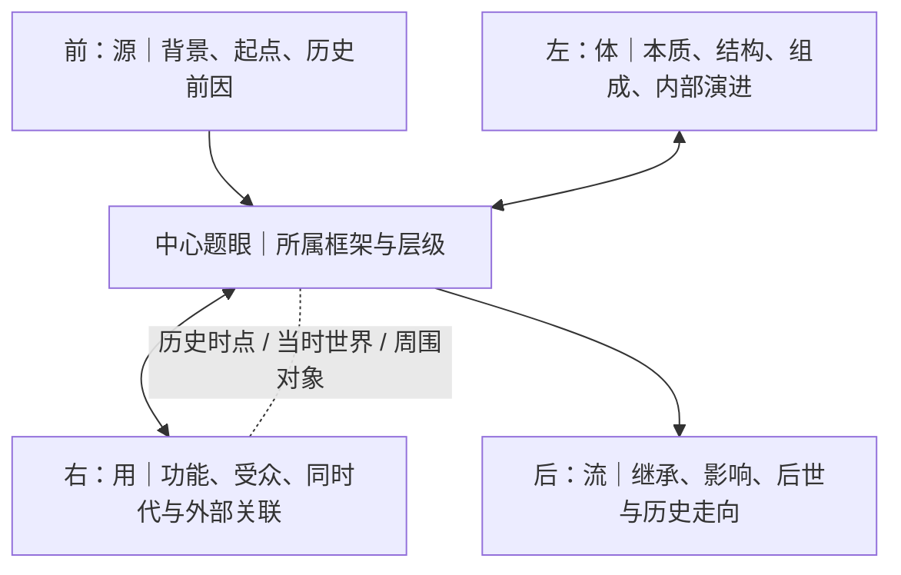

# 观复 Mind｜产品与工程 Skill 1.2

> **最高依据：** 实施任何产品、架构、交互或工程工作前，必须遵循 [《观复 Mind｜最高设计总纲》](GUANFU-MIND-DESIGN-CHARTER.md)、[V3.1 架构审议正式变更清单](MIND-V3.1-ARCHITECTURE-DECISIONS.md)、[V3.1 统一产品架构与 UI 设计任务书](MIND-DESIGN-TASKBOOK-V3.1.md) 与 [V3.2 架构一致性审查](MIND-V3.2-ARCHITECTURE-CONSISTENCY-REVIEW.md) 及优先级更高的 [V3.3 四向四维一体模型正式校正](MIND-V3.3-FOUR-DIRECTIONS-FOUR-DIMENSIONS-UNIFIED-MODEL.md)。若 V3.1/V3.2 中四向、四维拆分表述与 V3.3 冲突，以 V3.3 为准。本 Skill 是实现补充，不得覆盖用户已审议的 old / merge / new / later 决定。

## 1. 产品身份与目标

- 中文主名：**观复**
- 英文副名：**Mind**
- NEBULA：工程代号，不取代产品主名。
- 产品是认知定位与知识过滤界面，不是普通脑图、仪表盘或炫技知识图谱。
- 核心目标：建立用户自己的个人思维框架，让用户聚焦一点仍知全局。
- 核心顺序固定为：**定其位 → 联其缘 → 生其相 → 归其一**。
- “道生一”等哲学思想可作理念背景，不得替换或另立第二套产品操作流程。

## 2. 四向四维一体：中心题眼与四侧认知模型

**四向与四维是一体的同一个认知观察模型，不是两个独立系统。** 不得再把“四向探索”和“四维定位”拆成两套平行按钮、字段或流程。

先找到核心知识点（题眼），明确它在宏观框架中的位置和层级；再以题眼为中心，沿四侧观察。框架与层级、历史时间、当时世界及周围对象，是贯穿四侧的上下文。

### 前：源（发生学 / Why）
- 追溯历史传统、时代背景、制度与思想环境、时代局限。
- 寻找起点、初始矛盾、需求、触发事件、形成条件及前置人物/知识/事件。
- 可回到具体历史时点，重建当时的场景、参与者和可用条件。
- 区分直接来源、背景条件与后来的解释。

### 左：体（本体论 / What）
- 向内分析对象的定义、边界、本质、结构、属性、材料、组成、机制、标准与形成主体。
- 提取核心特征、题眼和底层矛盾。
- 观察对象内部结构、组成部分、方法或范式如何演进和突破。
- 辨析相近概念及适用边界。

### 右：用（价值论 / How）
- 向外观察功能、用途、价值、受众、适用场景和外部条件。
- 寻找同时代人物、事件、制度、作品、平级知识点及跨领域对象。
- 分析对象如何与外部世界交互、影响谁、受到谁影响。
- 关联当时的地域、制度、文化、社会、技术与知识环境。
- 同时代、同地域、同领域只代表关联线索，不自动证明因果或影响。

### 后：流（发展学 / Where）
- 追踪已经发生的继承、传播、演变、转折、影响和历史结果。
- 观察后世接受、批判、改造、评价与重新解释。
- 说明长期历史定位、意义和范式变化。
- 未来趋势或预测可以单独提出，但必须标明推测，不能与已发生的历史后续混写。

### 框架、时间与世界上下文
- 每个题眼必须尽可能明确属于哪个宏观框架、框架中的哪一层/分支；深入四侧时持续保留这一上下文。
- 时间不是单个年代标签：必要时回到发生、发展或转折的具体时点，分别观察前因、当时条件与后续。
- 世界/场景不只指地理位置，也可能包含制度、文化、社会、技术和知识环境；必须区分语义，知识领域不等于地理空间。
- 周围对象包括前置对象、同时代/平级对象、影响者、受影响者及后续对象；不同关系必须标明类型和依据。
- 回到某个历史时点时，要同时观察对象自身与当时周围世界，再展开前源、左体、右用、后流。

### 一体模型示意

**递归规则：** 每个新发现的知识对象都可成为新的中心题眼，重新沿四侧展开；每侧可以没有结果，也可以有多个结果；不预设固定层数，不要求每个对象填满四侧。路径要保留来路、进入侧面、关系上下文和返回能力。

## 3. 认知顺序与知识链展开

最高操作顺序仍固定为：**定其位 → 联其缘 → 生其相 → 归其一**。四向四维一体模型是围绕题眼开展认知观察的结构，不另立第二套流程。

- **定其位：** 找到题眼，明确适用场域、宏观框架、层级和底层矛盾。
- **联其缘：** 以「前源、左体、右用、后流」四侧一体观察，关联历史来源、内部本质、外部世界和后续流变。
- **生其相：** 把四侧观察结果组织成知识链、框架分支、关系网络和可追溯的知识结构。
- **归其一：** 回到核心题眼，说明各分支如何共同解释核心问题并完成整体收束。

### 口诀与树状知识链
- 用户提供的口诀必须先单独列出；没有口诀时标记“暂无”，不得伪称 AI 生成内容是用户口诀。
- 随后按口诀每个字标注对应知识含义，再展开知识树/逻辑分支。
- 分支可以涉及本体/特征、演进/技法、价值/影响等，但不强迫所有知识使用固定三分支。
- 每个分支连接具体知识对象、概念、现象、问题、发展、突破、对策、意义或地位，并尽可能保留来源与关系。
- 口诀是可选压缩索引，不替代完整知识、推理、原始资料和证据；口诀相似不代表知识相同。

## 4. 稳定知识身份、框架树与关系网络

### 稳定知识对象
知识对象拥有稳定 ID、名称/别名、对象类型及可维护的当前解释。身份不能由标题、路径或 XYZ 坐标生成。

### 主张与解释
同一对象可以承载多个来源、主体或语境下的主张/解释。主张应保留提出者、来源、适用语境、时间范围、状态和版本。不同主张可以互补、冲突或适用范围不同，不得为了“合并对象”而抹掉差异。

### 框架树
框架树表达某个特定框架中的主干、分支、上下位和结构归属。对象可出现在多个框架上下文中；框架中的位置和角色不等于对象身份。不得把单一 parentId 当作全局唯一归属。

### 关系网络
关系网络表达对象之间有类型的多对多语义关系。关系应尽可能有类型、方向（适用时）、上下文、理由、证据和审核状态。父子层级、横向关系、空间邻近不得混成同一类边。

### 三维空间地图
真实 Three.js/WebGL XYZ 空间用于投影、聚焦、探索和导航。布局坐标是呈现信息，不是知识事实；可按视图重新布局，但不能因此改变知识身份、关系或框架归属。

## 5. 探索路径与认知回放

探索路径记录用户如何抵达对象，而不是创建另一个对象。概念上可记录起点、当前焦点、访问序列、每步进入方向、关系上下文、来源引用、时间和返回点。

- 多条路径可抵达同一稳定知识对象。
- 路径可分叉、回退、切换和继续深入。
- 路径不自动改变知识对象、框架位置或关系事实。
- 回放可聚合知识版本、路径事件、审核决策和学习记录，但必须保留事件类型。
- 回放默认只读；恢复旧版本须用户明确执行。
- 知识历史、用户学习时间、历史事件时间不可混为一个时间字段。

## 6. 原始输入、专业纠错与 AI 认知分析

### 原文保全
原始文件、原始转写、原文片段和定位信息必须保留。任何提取、规范化或纠错都不得覆盖原始来源。

### 专业语境纠错
流程固定为：

**原始识别保留 → 专业语境分析 → 候选纠正 → 展示理由/来源/不确定性 → 用户确认**

- 覆盖语音识别、文字输入和文档提取中的专业术语、人名、作品名、年代和概念误识。
- 用户确认后保存“原始表达 ↔ 确认修正”的可追溯关系。
- 未确认不得静默替换；无法判断时保留候选或待确认状态。
- 不得凭专业背景臆造来源或确定答案。

### AI 认知分析
AI 纳入既有过滤顺序，执行专业语境识别、题眼/底层矛盾提取、定位建议、结构拆解、围绕题眼的前源、左体、右用、后流四侧一体分析、重复/冲突/缺口识别和整体归纳。

AI 必须区分：
- 原始来源事实；
- 用户观点；
- AI 推断；
- 待确认建议；
- 用户已确认内容。

AI 只生成候选/ReviewProposal。正式知识、关系或框架变更必须经用户审核；不得静默合并、覆盖、重设父级或更改正式框架。

## 7. 口诀机制

口诀是可选知识压缩索引：
- 用户可输入，AI 可提出候选。
- 用户确认后才成为正式索引。
- 一个口诀可关联多个知识对象，一个对象可关联多个口诀。
- 口诀相似不代表知识相同，不得自动合并。
- 口诀不强制，不替代完整知识、推理、来源和证据。

## 8. 来源与证据边界

必须保留来源记录、原文定位、证据状态、不确定性和 AI 推断标识。关系证据应能回链到来源与定位。

**第 10 项独立证据可靠性体系仍处于 later：** 不新增独立证据评分、来源权重或自动可信度排序引擎，除非用户未来另行批准。保留现有追溯能力，不得因暂缓而删除。

## 9. 空间化与视觉规范（old，未经授权不得改）

- 保留用户已确认的原版深黑宇宙、克制低亮度、真实三维空间、柔和受控微光、清晰文字、低干扰小地图与收敛侧栏。
- 不擅自新增星云、星球、轨道、粒子、霓虹、大光环、厚重卡片或常驻 HUD。
- 不擅自修改 Logo、主题、主色、节点样式、光效、导航结构或空间组织。
- 不把 DeepSeek 文字代码框、文字四维图、口诀模板或答题模板直接转成 UI。
- 四向四维必须作为中心题眼周围的一个整体认知模型理解；不得拆成两套独立系统。任何 UI 表达须等架构通过后单独设计并经用户确认。
- 逻辑结构视图与三维宇宙共享稳定知识身份和关系，但不能将两者强行合成同一套视觉结构。

## 10. 本地优先与隐私

- 默认本地优先，知识图谱、讲义和提取内容保存在用户本地浏览器 IndexedDB。
- 无注册、无登录、无自动云端整库同步；不得擅自引入 Clerk、Supabase、D1、R2 或百度网盘。
- 网页不得静默扫描本机文件夹；只能在用户主动选择/授权后访问。
- 只有用户主动调用 AI 分析时，才发送用户明确选中的最小必要文本。
- 不索取账号密码、Cookie、验证码或模型密钥；不宣称端到端加密。
- 数据备份、恢复、导出应由用户主动操作并提供清晰状态。

## 11. 工程与数据迁移原则

- 继续使用 IndexedDB 等可移植本地存储；保留旧 localStorage 兼容路径。
- 原始资料与提取候选分开；正式知识与审核提案分开。
- 数据模型演进必须增量迁移，保留旧数据、备份和回滚方案。
- 在确认真实代码接口前，不得只凭历史文档假定实体或字段已实现。
- 概念模型不等于数据库 schema。任何 schema 变更都需单独列明字段、迁移、旧数据兼容、测试和回滚，并取得授权。
- 代码存在、UI 已接入、服务已部署、自动化测试通过、真实浏览器端到端验收通过，必须分别标记。

## 12. 工作交付规范

每轮项目汇报必须说明：
1. 用户提出的问题；
2. 原因定位（未确认须标待定位）；
3. 正在执行方案与进度（已完成/进行中/待验证）；
4. 测试、部署状态与可打开预览链接；
5. 可能遇到的困难及应对；
6. 整体任务列表中的当前位置与下一步。

每个完成版本单独提交，提供可核实的文件/提交/预览链接。自动化检查成功不得描述为真实浏览器验收成功。架构文档提交不得描述为 UI 或产品功能已上线。

## 13. 阶段门

- **阶段 A｜统一产品架构：** 统一术语、对象边界、树/网/地图、四向/四维、路径、AI审核、纠错、口诀和回放。未通过前不启动 UI 设计。
- **阶段 B｜数据与交互规格：** 对照真实代码确定实体复用/新增、路径与多框架身份规则、纠错映射、事件回放、备份和迁移方案。不得直接实施 schema。
- **阶段 C｜UI 设计：** 仅在架构通过后，在原版空间界面基础上设计，逐项由用户确认。
- **阶段 D｜工程实现：** 必须另行授权；按小版本提交并完成自动化、浏览器实测和回滚说明。

**总验收原则：身份稳定、关系有型、路径可追、定位不丢、原文不改、AI 不越权、视觉不擅改。**
